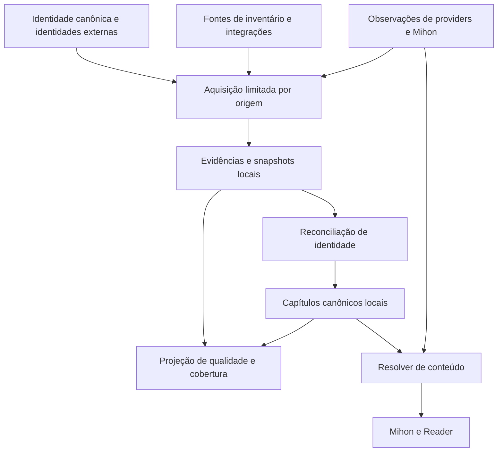
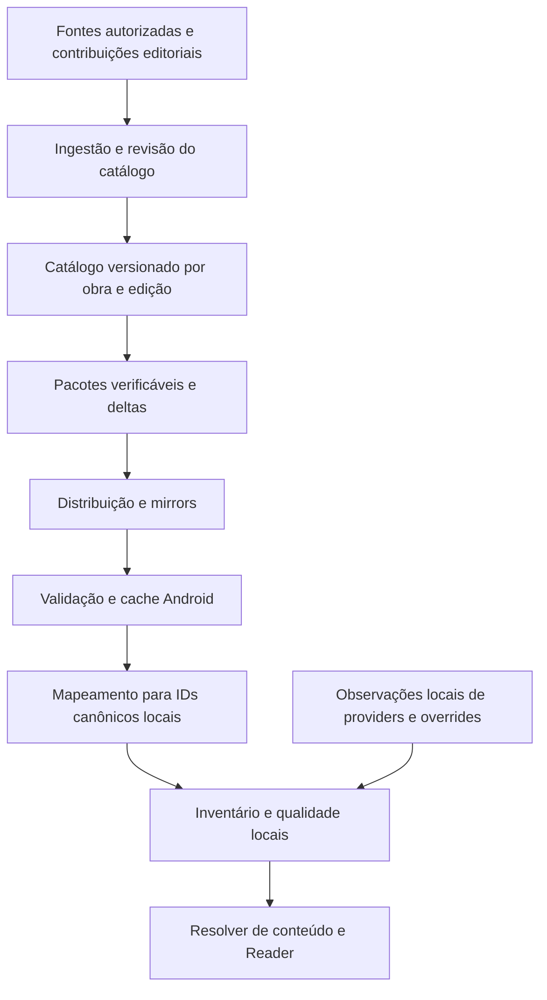

# Relatório A — Issue #154

> Registro da investigação de 24/10/2026, publicado posteriormente a pedido do usuário. O conteúdo abaixo preserva o relatório entregue na conversa. Estados de Git, CI, commits, PRs e ausência de alterações referem-se ao encerramento da investigação, antes desta publicação documental. A publicação não aprova arquitetura, implementação ou release.

[Índice da pesquisa](README.md)

## 1. Resumo executivo

O problema tem três camadas distintas:

| Camada | Pergunta | Resultado da investigação |
|---|---|---|
| Existência e identidade | Quais capítulos são conhecidos individualmente? | Já existe reconciliador canônico, mas faltam produtores independentes efetivamente conectados pelas integrações atuais. |
| Qualidade do conhecimento | O que sustenta cada afirmação e até onde ela vale? | Há proveniência básica e estados de confirmação; faltam semânticas suficientes de abrangência, derivação, completude e revisão das evidências. |
| Disponibilidade | Onde é possível ler determinado capítulo? | Existem caminhos operacionais para Mihon, SCRIPT e torrent/P2P; suas capacidades não devem determinar a existência do inventário. |

Os achados principais são:

1. **A independência dos providers já tem uma fronteira arquitetural prevista.** `ChapterEvidenceProvider` e `IntegrationRegistry.chapterEvidenceProviders()` existem. Entretanto, as integrações atuais não implementam esse contrato.
2. **O coletor SCRIPT associa descoberta de inventário a capacidades de entrega.** Exige simultaneamente `reading.lookup`, `reading.chapters` e `reading.pages`.
3. **Contagens já geram posições individuais no outline.** Essas posições recebem IDs determinísticos e podem ser persistidas quando abertas. Embora diferenciadas como inferidas/provisórias, esse comportamento conflita com o contrato mais estrito da issue #154.
4. **Um capítulo persistido pode desaparecer da apresentação sem ser apagado do banco.** A retirada de suporte de um provider pode tornar um capítulo provisório invisível quando não há progresso, download ou outro suporte.
5. **A existência de uma API de capítulos não garante qualidade editorial.** O Kitsu possui recursos individuais, mas seu código também gera registros sequenciais a partir de contagens.
6. **As proteções de #140 e #141 precisam ser preservadas.** Numeração exata, progresso, backup e restore têm barreiras deliberadas; não estão liberados para uma migração automática.

A recomendação é separar aquisição de conhecimento, interpretação desse conhecimento e resolução de conteúdo. O Reader continua usando os mecanismos atuais.

Nenhuma das duas arquiteturas propostas pode prometer uma lista completa quando nenhuma fonte fornece informação suficiente.

## 2. Baseline, fontes e limites da evidência

### Baseline confirmado

| Item | Valor |
|---|---|
| Tsuzuki `origin/main`, confirmado no início e no encerramento | `b0417cdf232e220fe8f7f89f3e156d2d26765883` |
| Tree investigada | `a032cbef0149cf62f340063da845ad75d6fc27f3` |
| Checkout original | `c6b45874106f6b0a833e91972bea1dcd9a05ffd7` |
| Worktree de pesquisa | `C:\Users\joaop\AppData\Roaming\Projects\Tsuzuki-issue154-research` |
| Estado da worktree | Detached HEAD |
| Issue #154 | Aberta; nenhum comentário retornado pela consulta |
| Alterações versionadas | Nenhuma |

A referência histórica `b0417cdf…` foi, portanto, confirmada como o `main` atual, e não escolhida arbitrariamente. A [issue #154](https://github.com/jssantogit/tsuzuki/issues/154) foi usada como contrato principal.

Foram consultados `AGENTS.md`, a especificação, o workflow de desenvolvimento, as regras locais, a política Android, o plano de capítulos canônicos e os contratos posteriores de numeração, progresso e backup.

### PRs e trabalhos relacionados

| Trabalho | Estado verificado | Consequência para esta decisão |
|---|---|---|
| [#140](https://github.com/jssantogit/tsuzuki/pull/140) | Merged; merge `8162a795…` | Proteções do reconciliador e rollout de numeração/progresso fazem parte do baseline. |
| [#141](https://github.com/jssantogit/tsuzuki/pull/141) | Merged; merge `32b60a55…` | Isolamento de contas e hardening de backup já estão integrados; ativação do backup canônico continua separada. |
| [#153](https://github.com/jssantogit/tsuzuki/pull/153) | Aberta, Draft; HEAD consultado `b21ca4eb…` | Trilha visual; não resolve o inventário. |
| [#152](https://github.com/jssantogit/tsuzuki/pull/152) | Presente no histórico de `main`, em `2e09e189…` | Diagnósticos/aquisição P2P posteriores foram considerados; não substituem enumeração independente. |
| #149–#151 | Consultadas como trabalhos relacionados | Diagnóstico de aquisição e matching não deve ser usado como prova de inventário nem incorporado ao escopo desta decisão. |

As execuções [#40099442762](https://github.com/jssantogit/tsuzuki/actions/runs/40099442762), da HEAD de #140, e [#40106183310](https://github.com/jssantogit/tsuzuki/actions/runs/40106183310), da HEAD integrada de #141, estavam concluídas com sucesso.

Isso é evidência histórica desses commits. **Não executei testes, builds, emuladores ou probes de leitura nesta investigação.**

No SHA atual, a consulta de Actions também encontrou um APK Build bem-sucedido e outro falho. O falho, [#40116830171](https://github.com/jssantogit/tsuzuki/actions/runs/40116830171), falhou em **Resolve APK lane**. Não constitui evidência de falha do Chapter Engine.

### Notion: vigente versus histórico

Foram lidas as páginas:

- [Current State](https://app.notion.com/p/3ebfe7e229fd817f9a7dc9d608984e2a);
- [Decisions](https://app.notion.com/p/3ebfe7e229fd816f923ef1acf7bff772);
- [Architecture](https://app.notion.com/p/3ebfe7e229fd81ac9f8dea3e04a61bfa);
- [Known Bugs](https://app.notion.com/p/3ebfe7e229fd812f9062face983d3fb4);
- [Providers & Sources](https://app.notion.com/p/3ebfe7e229fd8134a0a2e299b0211266);
- [Reader](https://app.notion.com/p/3ebfe7e229fd8112b152dc96222ca6c8).

Há documentação histórica ainda dizendo que #140/#141 estão Draft e que suas migrações colidem em `43.sqm`. As atualizações de Current State e o GitHub registram os merges; o baseline já contém a sequência reconciliada.

Também permanecem cabeçalhos históricos de Draft em documentos do repositório. **Estado de merge foi resolvido pelo GitHub e pela árvore atual; restrições de ativação continuam válidas quando confirmadas no código.**

Nenhuma página foi alterada.

## 3. Diagnóstico auditável

### 3.1. Fluxo efetivamente implementado

```text
CatalogItem / identidades externas verificadas
    → materialização de CanonicalTitle
    → metadados e contagens reportadas

Tela canônica / refresh / vínculo de leitura
    → RefreshChapterEvidence
        ├─ ChapterEvidenceProvider das integrações
        ├─ probes dos Add-ons Mihon
        └─ CollectProviderReadingEvidence para SCRIPT
    → parser + seleção conservadora de identidade
    → ReconcileChapterEvidence
    → transação de capítulos/evidências/projeções operacionais
    → snapshots e invalidação de opções de conteúdo
    → projeção da tela + outline derivado de contagem

Ação de leitura
    → OpenCanonicalChapter
    → eventual materialização de posição inferida
    → PrepareCanonicalChapterForReader
        ├─ download local reutilizável
        ├─ opções de conteúdo/Mihon
        ├─ fallback SCRIPT
        └─ fallback torrent/P2P
    → conteúdo preparado
    → Reader
```

Esse fluxo já contém fronteiras úteis. O problema não é ausência total de separação canônica: é a combinação de produtores insuficientes, semânticas de conhecimento incompletas e projeções ainda dependentes de suporte operacional.

### 3.2. Evidências principais

Todos os links de código abaixo estão fixados no SHA investigado.

| Ref. | Local | Evidência |
|---|---|---|
| E1 | [IntegrationCapabilities.kt](https://github.com/jssantogit/tsuzuki/blob/b0417cdf232e220fe8f7f89f3e156d2d26765883/domain/src/main/java/tachiyomi/domain/tsuzuki/integration/IntegrationCapabilities.kt) | `ChapterEvidenceProvider.evidenceFor()` já permite produtores sem leitura. |
| E2 | [DefaultIntegrationRegistry.kt](https://github.com/jssantogit/tsuzuki/blob/b0417cdf232e220fe8f7f89f3e156d2d26765883/app/src/main/java/eu/kanade/tachiyomi/data/tsuzuki/integration/DefaultIntegrationRegistry.kt) | O conjunto de produtores é injetável, vazio por padrão e filtrado por configuração. |
| E3 | [CollectProviderReadingEvidence.kt](https://github.com/jssantogit/tsuzuki/blob/b0417cdf232e220fe8f7f89f3e156d2d26765883/domain/src/main/java/tachiyomi/domain/tsuzuki/provider/reading/CollectProviderReadingEvidence.kt) | Elegibilidade SCRIPT exige lookup, chapters e pages; binding automático aceita um único candidato de título/alias normalizado exato. |
| E4 | [RefreshChapterEvidence.kt](https://github.com/jssantogit/tsuzuki/blob/b0417cdf232e220fe8f7f89f3e156d2d26765883/domain/src/main/java/tachiyomi/domain/tsuzuki/chapter/evidence/RefreshChapterEvidence.kt) | Coleta concorrente, publicação progressiva, snapshots, TTL e invalidação. |
| E5 | [ReconcileChapterEvidence.kt](https://github.com/jssantogit/tsuzuki/blob/b0417cdf232e220fe8f7f89f3e156d2d26765883/domain/src/main/java/tachiyomi/domain/tsuzuki/chapter/evidence/ReconcileChapterEvidence.kt) | Reconciliação transacional, proteção contra observações antigas, conflitos e retirada de suporte. |
| E6 | [BuildCanonicalChapterOutline.kt](https://github.com/jssantogit/tsuzuki/blob/b0417cdf232e220fe8f7f89f3e156d2d26765883/domain/src/main/java/tachiyomi/domain/tsuzuki/chapter/interactor/BuildCanonicalChapterOutline.kt) | Usa a maior contagem positiva e produz posições `1..N`, limitadas a 5.000. |
| E7 | [MaterializeInferredChapter.kt](https://github.com/jssantogit/tsuzuki/blob/b0417cdf232e220fe8f7f89f3e156d2d26765883/domain/src/main/java/tachiyomi/domain/tsuzuki/chapter/interactor/MaterializeInferredChapter.kt) | Uma posição inferida pode virar linha persistida quando necessária à ação. |
| E8 | [CanonicalTitleScreenModel.kt](https://github.com/jssantogit/tsuzuki/blob/b0417cdf232e220fe8f7f89f3e156d2d26765883/app/src/main/java/eu/kanade/tachiyomi/ui/tsuzuki/detail/CanonicalTitleScreenModel.kt) | Filtra visibilidade por confirmação, progresso, suporte ou download; acrescenta posições de contagem. |
| E9 | [ChapterEvidence.kt](https://github.com/jssantogit/tsuzuki/blob/b0417cdf232e220fe8f7f89f3e156d2d26765883/domain/src/main/java/tachiyomi/domain/tsuzuki/chapter/evidence/ChapterEvidence.kt) e [SQL de evidências](https://github.com/jssantogit/tsuzuki/blob/b0417cdf232e220fe8f7f89f3e156d2d26765883/data/src/main/sqldelight/tachiyomi/data/tsuzuki_chapter_evidence.sq) | Proveniência básica existe; atualizações substituem a observação de mesmo ID, sem constituir um histórico completo de revisões. |
| E10 | [ProviderChapterEvidenceAdapter.kt](https://github.com/jssantogit/tsuzuki/blob/b0417cdf232e220fe8f7f89f3e156d2d26765883/domain/src/main/java/tachiyomi/domain/tsuzuki/provider/reading/ProviderChapterEvidenceAdapter.kt) | IDs incluem o binding; confiança atribuída é `0.95`; idioma, grupo e data da observação não entram no `ChapterEvidence`. |
| E11 | [ParseCanonicalChapterLabel.kt](https://github.com/jssantogit/tsuzuki/blob/b0417cdf232e220fe8f7f89f3e156d2d26765883/domain/src/main/java/tachiyomi/domain/tsuzuki/chapter/interactor/ParseCanonicalChapterLabel.kt) | Parser conservador; numeração exata possui preview separado, explicitamente fora do fluxo produtivo de reconciliação. |
| E12 | [PrepareCanonicalChapterForReader.kt](https://github.com/jssantogit/tsuzuki/blob/b0417cdf232e220fe8f7f89f3e156d2d26765883/domain/src/main/java/tachiyomi/domain/tsuzuki/reader/interactor/PrepareCanonicalChapterForReader.kt) | Existência de capítulo e preparação de conteúdo já são etapas distintas. |

### 3.3. Achados classificados

Severidade representa impacto sobre o contrato da #154; não significa que todos os achados sejam bugs recém-introduzidos.

| Achado | Classificação | Severidade | Evidência e consequência |
|---|---|---:|---|
| Não há implementação atual de integração contribuindo por `ChapterEvidenceProvider` | **FATO CONFIRMADO** | Alta | E1/E2 e bindings das integrações. A fronteira existe, mas não fornece enumeração independente hoje. |
| Inventário SCRIPT exige também entrega de páginas | **FATO CONFIRMADO** | Alta | E3. Um produtor apenas enumerador fica excluído desse caminho, mesmo que pudesse fornecer conhecimento válido. |
| Contagens produzem posições com identidades individuais | **FATO CONFIRMADO** | Alta | E6/E7. Contraria a proibição da #154 de fabricar capítulos/IDs a partir de totais. |
| Retirada de suporte pode ocultar capítulos já conhecidos | **FATO CONFIRMADO** | Alta | E5/E8. O banco preserva a linha, mas a experiência de inventário pode deixar de mostrá-la. |
| `complete` na coleta significa conclusão técnica, não completude da obra | **FATO CONFIRMADO** | Média | E4. Inclui sucesso vazio e ausência de targets; não prova cobertura editorial. |
| Confirmação editorial é uma classe ampla demais para fontes heterogêneas | **RISCO** | Alta | E5/E9. `EDITORIAL` promove confirmação; uma futura integração mal classificada poderia legitimar dados derivados ou incompletos. |
| Proveniência não preserva plenamente derivação, escopo e revisões | **FATO CONFIRMADO** | Média | E9/E10. Há origem e timestamp, mas falta distinguir observação direta, registro gerado de contagem e cópia de outra fonte. |
| Idioma/edição não estão representados suficientemente no contrato de evidência | **RISCO** | Alta | E9/E10. Facets e bindings ajudam, mas não substituem um escopo explícito de enumeração. |
| Novos dados exatos podem ultrapassar os contratos legados de progresso | **RISCO** | Alta | E11 e contrato de rollout. A issue não pode ativar silenciosamente a numeração/progresso v2. |
| Os seis refreshes vazios decorreram da combinação de elegibilidade e ausência de produtores independentes | **HIPÓTESE fortemente compatível** | Alta | O caminho está demonstrado no código; a configuração e o smoke vêm da issue/Notion, sem reprodução nesta sessão. |
| Parser globalmente quebrado | **HIPÓTESE não sustentada** | — | Zero observações a montante não demonstra erro de parsing. |
| Garantir inventário universal sem fontes informativas | **LIMITAÇÃO EXTERNA** | Alta | Nenhuma reorganização interna recupera informação que não foi fornecida. |

### 3.4. Descoberta, matching e identidade

O coletor SCRIPT:

- considera providers habilitados, runtime SCRIPT e o trio de capacidades;
- ordena targets por provider/facet;
- reutiliza bindings disponíveis;
- procura correspondência única de título/alias normalizado;
- limita lookup a oito páginas e 2.000 itens;
- limita concorrência a quatro providers.

Essa igualdade exata é mais conservadora que fuzzy matching, mas **não prova sozinha equivalência entre edições**. Duas obras homônimas ou uma reedição estruturalmente diferente continuam sendo um risco. As arquiteturas propostas exigem identidade externa verificada, crosswalk verificável ou confirmação explícita quando necessário. Não propõem relaxar Nyaa/P2P.

A reconciliação atual já:

- reutiliza mapeamentos por chave externa;
- diferencia tipos, partes, sufixos e volumes;
- evita unir extras sem numeração apenas pelo tipo;
- preserva conflitos;
- impede observações antigas de substituir informações mais novas;
- protege identidades exatas persistidas;
- limita consolidação de duplicatas quando existe estado protegido.

Esses mecanismos devem ser reaproveitados.

### 3.5. Persistência, refresh, falhas e offline

Há dois níveis diferentes de cache:

| Mecanismo | Comportamento observado |
|---|---|
| Snapshot de refresh canônico | TTL de 15 minutos; fingerprint de configuração; force refresh ignora frescor. |
| Cache de inventário Mihon | TTL de dois minutos; limite de 128 entradas. |
| Snapshot por binding | Permite evitar reconciliação de inventário inalterado. |
| Opções de conteúdo | Invalidadas após mudanças relevantes de evidência. |

A coleta publica estágios progressivamente. A reconciliação usa gate de mutação e transações. O caminho legado reúne os inventários selecionados antes de projetar capítulos e variantes.

O refresh SCRIPT só publica seu snapshot depois de terminar a paginação; limita a 32 páginas e 16.000 observações, rejeitando cursores repetidos e IDs duplicados. **Paginação encerrada significa snapshot completo daquele endpoint/binding, não catálogo completo da obra.**

Falhas e cancelamentos são distintos. O gateway SCRIPT delega limites ao runtime e revalida registro/pacote. Não encontrei no orquestrador de evidências uma política universal de retry/backoff que possa ser tratada como garantia para todos os produtores. As propostas devem especificar essa política na fronteira de aquisição, respeitando o comportamento de cada API.

Offline, as linhas persistidas continuam disponíveis. Entretanto, o filtro de apresentação por suporte mostra por que **persistência preservada não equivale automaticamente a inventário preservado na UI**.

### 3.6. Testes revisados

Foram examinados contratos e assertivas de:

| Área | Evidência revisada | Limite |
|---|---|---|
| Outline | `BuildCanonicalChapterOutlineTest` | Confirma geração deliberada de posições por contagem; não prova existência real. |
| Abertura | `OpenCanonicalChapterTest` | Confirma passagem pela materialização das posições inferidas. |
| Coleta SCRIPT | `CollectProviderReadingEvidenceTest` | Lookup único, binding reutilizado, ambiguidade e falha. |
| Integração do refresh | `RefreshChapterEvidenceProviderReadingTest` | Publicação de snapshots, inclusive vazios, ao reconciliador. |
| Reconciliação | `ReconcileChapterEvidenceTest` | Retirada de suporte, snapshot antigo, promoção editorial, conflitos, volumes e semânticas especiais. |
| Persistência | Repositórios de capítulos, evidências e snapshots | Transações, identidade exata, idempotência e proteção contra atualizações antigas. |
| Numeração/progresso | Parser exato, sync keys e contratos de rollout | Separação explícita entre legado e v2. |
| Reader/downloads | Código e matriz de aceitação existentes | Download persistido precisa de verificação física de reutilização. |

Uma lacuna importante: o teste chamado “chapter count without evidence creates no canonical chapter rows” exercita o reconciliador vazio. **Não cobre o caminho posterior outline → abertura → materialização.**

Os testes foram **revisados, não executados**. Evidências Android documentadas em SHAs anteriores não foram promovidas a resultados do baseline atual.

## 4. Integrações e alternativas externas

Consulta realizada em **24/10/2026**. A análise distingue capacidade da API, contribuição implementada e cobertura não demonstrada.

### 4.1. Integrações existentes

| Fonte | Contribuição atual no Tsuzuki | Capacidade externa verificada | Limite para #154 |
|---|---|---|---|
| MyAnimeList | Metadados, ratings, listas/tracking; contagem no modelo | API v2 fornece `num_chapters` e `num_volumes`; zero pode significar desconhecido | Não foi identificado contrato de enumeração individual no conjunto de endpoints auditado. |
| Kitsu | Metadados, ratings, listas/tracking e contagem | Recursos `chapters`, com número, volume, títulos e publicação | Registros podem ser gerados de contagem; IDs não bastam como prova independente. |
| MangaUpdates | Metadados, ratings e listas/tracking | Releases individuais com ID, volume/capítulo em texto, grupos e data | Release pode representar faixa, volume ou conjunto; não equivale necessariamente a um capítulo canônico. |
| Bangumi | Metadados, ratings e listas/tracking | `/v0/episodes` enumera unidades por subject, com paginação e IDs | Cobertura e semântica para livros/mangás não foram demonstradas por corpus real. |
| Shikimori | Busca, metadados e ratings no adapter examinado | API/documentação existente; documentação completa não pôde ser extraída nesta sessão | Nenhuma contribuição individual ao inventário está implementada; não assumir enumeração. |
| Hikka | Busca, metadados e ratings | OpenAPI `0.4.4`: `chapters` é inteiro ou nulo; há endpoints de manga | O campo é contagem, não coleção de capítulos. |
| Komga/Kavita/Suwayomi | Integrações pessoais, com políticas próprias | Catálogo/inventário do servidor configurado | Conhecem o acervo daquela instalação; não são bibliografia universal. |
| Mihon/Add-ons | Inventário operacional por fonte | Listas e variantes reais da fonte | Devem continuar contribuindo, sem controlar a existência do catálogo. |
| SCRIPT de leitura | Lookup, capítulos e páginas | Observações passam pelo adapter existente | Hoje o caminho exige também pages. |
| Torrent/P2P | Busca e aquisição | Candidatos e arquivos para uma requisição conhecida | Não devem ser promovidos automaticamente a enumeração canônica. |

O [registro de manifests](https://github.com/jssantogit/tsuzuki/blob/b0417cdf232e220fe8f7f89f3e156d2d26765883/app/src/main/java/eu/kanade/tachiyomi/data/tsuzuki/integration/DefaultIntegrationManifests.kt) também distingue políticas de uso global e servidores pessoais. Uma capability tecnicamente possível não deve ignorar essas políticas.

### 4.2. Kitsu: oportunidade real, com restrição decisiva

O [recurso oficial de capítulos](https://github.com/hummingbird-me/kitsu-server/blob/the-future/app/resources/chapter_resource.rb) expõe títulos, número, volume, publicação e relação com manga.

Porém, o [modelo Manga](https://github.com/hummingbird-me/kitsu-server/blob/the-future/app/models/manga.rb) chama `create_defaults` quando muda a contagem; o [modelo Chapter](https://github.com/hummingbird-me/kitsu-server/blob/the-future/app/models/chapter.rb) cria números sequenciais com volume padrão. O fluxo também pode usar o estado `validated`.

**Consequência:** não é seguro converter todos esses registros em evidência editorial confirmada. O adapter precisará provar a origem informativa de cada registro ou classificá-lo como derivado/insuficiente. Mesmo um título preenchido não elimina automaticamente essa necessidade.

Essa é uma oportunidade de ampliar a integração existente, mas não uma solução pronta para completude.

### 4.3. MangaUpdates: releases como evidência parcial

A especificação oficial, obtida da página da [API MangaUpdates](https://api.mangaupdates.com/), contém:

- busca de releases;
- consulta por ID;
- `volume` e `chapter` como strings;
- grupos, data de release e timestamps.

A política exige atribuição, espaçamento razoável entre chamadas e cache; não fornece garantia de disponibilidade ou correção.

Um release “10–12” deve continuar sendo uma afirmação sobre uma faixa até existir prova suficiente para desdobrá-lo. Não se devem fabricar três registros individuais a partir dessa string. Datas de release de um grupo também não devem ser reinterpretadas como data da publicação original.

### 4.4. Bangumi: candidato complementar, sem promessa de cobertura

A [especificação oficial](https://raw.githubusercontent.com/bangumi/server/master/openapi/v0.yaml) oferece enumeração por subject, IDs, nomes, ordem e datas. O endpoint aceita paginação, com limite máximo documentado de 200.

Isso justifica um piloto de inventário independente. Não prova que obras em forma de livro têm capítulos detalhados ou que a estrutura corresponde à edição usada pelo Tsuzuki. Autenticação opcional do endpoint não elimina restrições de conteúdo nem a necessidade de verificar uso e cobertura.

### 4.5. MangaDex: enumeração útil, ligada ao catálogo de releases

A especificação oficial foi obtida diretamente de `https://api.mangadex.org/docs/static/api.yaml`, porque o extrator web não conseguiu abrir a página. Ela documenta feed da obra e capítulos com UUID, número e volume em texto, título, idioma, versão e datas.

É uma candidata útil para um adapter **de inventário**, independente da instalação de um provider capaz de abrir páginas. Mas seu catálogo representa releases disponíveis naquele serviço; não certifica tudo que foi publicado na obra.

A [política oficial](https://gitlab.com/mangadex-pub/mangadex-api-docs/-/raw/main/index.md) exige atribuição e restringe anúncios/serviços pagos. A [documentação de limitações](https://api.mangadex.org/docs/2-limitations/) informa aproximadamente cinco requisições por segundo por IP, User-Agent identificável e tratamento de `429`. Esses limites devem ser aplicados por origem, não multiplicados por adapter.

### 4.6. Catálogos bibliográficos, índices e projetos semelhantes

| Alternativa | Resultado | Decisão |
|---|---|---|
| MangaBaka | Declara que metadados individuais de capítulos ainda estão planejados | Útil para identidade/metadados; rejeitada como solução atual de enumeração. |
| Open Library | API distingue Work/Edition e pode fornecer sumário | Complemento para edições/TOCs; cobertura de manga não demonstrada. |
| NDL Search | Busca e harvesting bibliográfico | Útil para identidade editorial e volumes; sem promessa de capítulos individuais. |
| Google Books | Recurso de volume com ISBN, idioma, edição e publicação | Não foi identificado inventário geral de capítulos de manga nesse contrato. |
| Komga/Kavita | Inventários de bibliotecas pessoais | Bom exemplo de catálogo local persistente; acervo possuído não equivale à estrutura completa publicada. |
| Jikan | API relacionada ao catálogo MAL | Não resolve a ausência de enumeração apenas por intermediar outra API. |
| AniList | Restrições documentadas pelo projeto; documentação oficial de termos consultada retornou `403` | Não recomendada para introdução nesta decisão. |
| Scraping indiscriminado | Cobertura, manutenção e permissões não garantidas | Rejeitado como fundação obrigatória. |
| Gerar `1..count` | Produz aparência de cobertura sem informação individual | Rejeitado pelo contrato da #154. |
| Índice publicado próprio | Tecnicamente viável se houver dados e direitos adequados | Desenvolvido como arquitetura B. |

Fontes: [MangaBaka — escopo](https://mangabaka.org/pages/policy/18-content-scope-strengths-roadmap), [Open Library](https://openlibrary.org/dev/docs/api/books), [NDL](https://ndlsearch.ndl.go.jp/en/help/api), [Google Books](https://developers.google.com/books/docs/v1/reference/volumes), [Komga](https://komga.org/docs/openapi/series/) e [Kavita](https://www.kavitareader.com/docs/api/).

Um índice próprio não pode simplesmente republicar todos os dados agregados de terceiros. A [licença do MangaBaka](https://mangabaka.org/about/data-license), por exemplo, distingue suas contribuições dos dados de terceiros e não concede direitos gerais de redistribuição sobre estes.

### 4.7. Restrições que permanecem abertas

Não foram obtidos termos completos e quotas numéricas verificáveis para todas as integrações. Em particular, páginas dinâmicas ou indisponíveis limitaram a revisão de Kitsu/Shikimori/MAL; o OpenAPI do Hikka não declarou licença ou termos.

Esses pontos são **gates de adoção dos respectivos adapters**, não justificativa para inventar permissões. Não há medição de uptime, cobertura por mercado ou qualidade editorial de um corpus nesta sessão.

## 5. Contrato de conhecimento para as duas arquiteturas

Este contrato é comum às duas propostas; não constitui uma terceira arquitetura.

### 5.1. Separar as afirmações

O sistema precisa distinguir pelo menos:

| Afirmação | Exemplo | Pode criar capítulo? |
|---|---|---|
| Total reportado | “A edição possui 120 capítulos” | Não |
| Unidade individual observada | “Esta fonte identifica capítulo 12.5” | Sim, após validação de identidade |
| Intervalo ou release combinado | “Release 10–12” | Não desdobrar automaticamente |
| Disponibilidade | “Provider X oferece uma entrega para esse capítulo” | Não redefine identidade |
| Retração/correção | “A fonte corrigiu seu registro anterior” | Reavalia suporte; não apaga estado do usuário |
| Correção manual | “Estas duas unidades são distintas” | Override auditável, sem inventar proveniência externa |

A conclusão técnica de um fetch precisa ser separada da abrangência informativa da resposta.

### 5.2. Representação das seis dimensões

| Dimensão | Representação recomendada |
|---|---|
| Proveniência | Origem, identidade externa, locator verificável, observação, revisão e relação de derivação. |
| Confiança | Categorias justificáveis de suporte e motivo de aceitação; scores existentes permanecem técnicos, sem virar probabilidade de verdade. |
| Cobertura | Projeção por escopo: unidades conhecidas, total comparável quando existente e regiões não descritas. |
| Completude | Afirmação explícita, limitada a edição/tipo/tempo, com justificativa e expiração. |
| Atualidade | Instante observado, revisão/validador da fonte, última tentativa e próxima revalidação. |
| Concordância | Relações entre afirmações compatíveis ou conflitantes; fontes copiadas não contam automaticamente como independentes. |

**Não recomendo seis novas colunas em `CanonicalChapter`.**

A maior parte é um read model derivado de evidências, contagens e snapshots. As lacunas reais são escopo, derivação, revisão e significado da enumeração. Elas justificam contratos tipados e persistência aditiva específica.

O `raw_metadata BLOB` atual não deve virar um depósito arbitrário: o exportador canônico rejeita metadados opacos não suportados. Qualquer extensão precisa de codec versionado, validação e estratégia explícita de backup.

### 5.3. Estados e transições

Recomendo duas dimensões independentes.

**Extensão do conhecimento:**

- `UNKNOWN`: nenhuma unidade individual admissível;
- `PARTIAL`: unidades conhecidas sem prova de encerramento do escopo;
- `ENUMERATED_SCOPE`: enumeração encerrada para um escopo definido;
- `COMPLETE_AS_OF`: evidência suficiente de completude daquele escopo até uma data.

**Qualificadores:**

- corroborado;
- conflitante;
- desatualizado;
- derivado;
- sob revisão manual.

Exemplos de transição:

| Evento | Transição |
|---|---|
| Chega apenas total | Continua `UNKNOWN`, agora com contagem reportada |
| Chegam unidades individuais válidas | `UNKNOWN → PARTIAL` |
| Termina paginação de releases | Marca enumeração do endpoint; não necessariamente `COMPLETE_AS_OF` |
| TOC exaustivo de edição fechada, verificado | Pode justificar `COMPLETE_AS_OF` |
| Fonte diverge de outra | Acrescenta conflito; não escolhe automaticamente a maior contagem |
| Fonte falha ou fica vazia | Marca tentativa/frescor; preserva conhecimento anterior |
| Obra em andamento publica novidade | Reabre abrangência/revalida; mantém completude anterior apenas como histórica |
| Correção muda identidade | Preserva registro e estado protegido; exige reconciliação ou revisão |

### 5.4. Cenário 120 versus 80

O resultado correto é:

> **80 capítulos identificados. Uma fonte informa 120 no total. O inventário é parcial.**

Não existem quarenta registros adicionais.

`80/120 = 66,7%` só pode ser exibido como cobertura relativa se ambas as fontes contam a mesma edição e o mesmo conjunto de unidades. Se uma inclui extras, partes ou traduções e outra não, a fração é enganosa; mostrar os dois fatos separadamente.

Lacunas numéricas não demonstram ausência. O maior número observado também não é uma contagem.

### 5.5. Identidades especiais

- **Zero:** aceitar evidência específica; não criar zero a partir de placeholders de volume.
- **Decimais:** manter texto e semântica exata; não converter `12.05`, `12.5` e `12 Part 5` à mesma identidade.
- **Extras, prólogos e one-shots:** tipo sozinho não identifica unidade.
- **Partes:** distinguir parte ordinal de fração decimal.
- **Combinados/divididos:** representar relação de cobertura entre release e unidades; não atribuir equivalência destrutiva.
- **Volumes reiniciados:** volume integra o escopo de correspondência.
- **Idiomas:** idioma de release é diferente de identidade estrutural; compartilhamento exige compatibilidade demonstrada.
- **Edições:** estruturas incompatíveis não devem ser fundidas.
- **Correções manuais:** manter autor/origem local, motivo e precedência limitada; não fingir corroboração externa.

A UX pode resumir isso com “Parcial”, “Atualizado em…” e “Fontes divergem”, abrindo detalhes sob demanda. A falta de leitura deve aparecer separadamente: “Nenhuma opção de leitura disponível”.

## 6. Arquitetura A — Inventário local de evidências

### Conceito e propriedade

O dispositivo mantém o conhecimento canônico. Integrações, índices e providers fornecem afirmações; o domínio Tsuzuki decide como elas sustentam capítulos locais.

É uma evolução do pipeline existente, com uma fronteira própria de aquisição de inventário e uma projeção de qualidade.



### Componentes e responsabilidades

1. **Aquisição de inventário:** consulta apenas fontes elegíveis por identidade e política; não exige páginas.
2. **Contrato de lote:** descreve escopo, paginação, resultado técnico, revisão e abrangência declarada.
3. **Armazenamento de evidências:** conserva afirmações atuais e histórico necessário para correções/retrações.
4. **Reconciliador:** reutiliza o Chapter Engine, com validação explícita da qualidade antes de promover afirmações.
5. **Projeção de conhecimento:** calcula cobertura, conflitos, frescor e justificativas.
6. **Resolver de conteúdo:** continua selecionando entrega para uma identidade conhecida.

`ChapterEvidenceProvider` é o ponto inicial natural. Deve evoluir sem obrigar providers existentes a mudar imediatamente. A compatibilidade pode envolver adaptação do retorno antigo como enumeração parcial, com semânticas conservadoras.

### Descoberta e ingestão

A tela carrega o inventário local primeiro. Em seguida, a política de refresh consulta fontes independentes disponíveis para identidades verificadas. Providers e vínculos existentes contribuem em paralelo, sem serem pré-requisito.

Prioridade proposta:

1. observações locais persistidas;
2. fontes com identidade externa conhecida e escopo compatível;
3. inventários de bindings já seguros;
4. descoberta limitada adicional quando necessária.

O algoritmo evita fan-out universal. Há orçamento por origem, compartilhamento de requisições em voo e publicação progressiva de resultados válidos.

### Identidade e reconciliação

Cada fonte mantém sua chave externa. A chave de unicidade precisa incluir o escopo correto de obra/edição quando o identificador não for global.

Tsuzuki conserva o UUID canônico. Novas evidências podem enriquecer a identidade existente; não substituem UUID por ID externo.

O matching usa:

- vínculo externo verificado;
- tipo e numeração estruturada;
- volume/edição;
- partes e frações;
- relações explícitas quando releases combinam unidades;
- override manual quando a ambiguidade não é resolvível.

Conflitos não autorizam migração de progresso. Um resultado exato por título pode ajudar na descoberta, mas não basta para unir edições.

### Persistência e cache

Reaproveitar:

- capítulos e evidências existentes;
- contagens separadas;
- snapshots/fingerprints;
- gate e transações;
- bindings operacionais.

Adicionar apenas o necessário para:

- escopo e resultado do lote;
- derivação da afirmação;
- revisão/correção/retração;
- associações de edição quando não representáveis com segurança no modelo atual.

A projeção de qualidade é recomputável. Correções manuais, vínculos históricos e evidências não recuperáveis não podem ser descartados como cache.

### Atualizações incrementais e falhas

Usar ETag, revisão ou cursor quando a fonte os oferece. Onde não oferece, comparar snapshots normalizados.

Uma falha não avança cursor nem retira suporte. Resposta vazia só prova que aquele endpoint não retornou itens naquela observação.

Retirar disponibilidade operacional é diferente de invalidar a existência histórica. Uma retração explícita pode reduzir a confiança, preservando capítulo, referências e motivo.

A escrita de cada lote deve ser atômica e idempotente. Requisições concorrentes precisam de geração/revisão do lote, complementando timestamps; relógios de fontes não devem ser tratados como perfeitamente comparáveis.

### Sem providers ou sem fontes enumeráveis

Sem providers, o inventário obtido de integrações/índices continua consultável.

Sem nenhuma fonte enumerável:

- manter capítulos já conhecidos;
- apresentar totais como totais;
- informar conhecimento indeterminado;
- não criar posições numeradas;
- permitir que descoberta de conteúdo futura contribua com evidência real.

### Custos e manutenção

Qualitativamente:

- pouco custo operacional central;
- mais trabalho de adapters no app;
- rede e energia distribuídas entre dispositivos;
- armazenamento proporcional às obras acompanhadas;
- latência inicial dependente das fontes;
- boa experiência offline após aquisição.

Revisões devem ter retenção limitada e compactação que preserve proveniência necessária. Não é preciso guardar indefinidamente cada resposta HTTP bruta.

### Riscos e mitigação

| Risco | Mitigação |
|---|---|
| Diferentes dispositivos conhecem subconjuntos diferentes | Mostrar escopo/frescor; preservar identidade e não sincronizar inferências como verdade. |
| Adapter classifica dados derivados como diretos | Fixtures de proveniência e política de promoção por fonte. |
| Crescimento de evidências | Retenção tipada, índices e compactação auditável. |
| Fonte lenta prejudica refresh | Orçamentos independentes, resultados progressivos e cache local. |
| Mudança de parser reinterpreta legado | Preview/diff, sem reescrita automática de IDs protegidos. |

### Adoção e rollback

Adotar por fontes e por projeção, inicialmente em modo de comparação. Migrações futuras são aditivas; desativar a nova aquisição não apaga evidências nem volta o schema.

Os IDs `tsuzuki:count:*` existentes precisam de tratamento especial: preservar referências e estado, classificá-los como hipóteses legadas e impedir novas criações por contagem. Uma correspondência posterior só os promove quando demonstrada. Duplicatas com estado protegido permanecem para revisão.

Testes de aceitação devem cobrir todos os quinze cenários da seção 9, incluindo não regressão do Reader.

## 7. Arquitetura B — Catálogo independente publicado em pacotes versionados

### Conceito e propriedade

Uma cadeia editorial externa ao app mantém um índice de inventário e publica pacotes versionados por obra/edição. O Android consome esses pacotes e mantém sua projeção local.

A decisão estrutural é diferente da A:

- na A, o dispositivo adquire e reconcilia as fontes;
- na B, aquisição, revisão e publicação do catálogo são responsabilidade de uma operação independente.

O catálogo não fornece páginas e não possui os IDs canônicos locais do usuário.



### Componentes e responsabilidades

1. **Ingestores externos:** coletam apenas dados cuja aquisição e publicação sejam permitidas.
2. **Revisão do catálogo:** registra conflitos, correções, relações de edição e decisões.
3. **Publicador:** produz pacotes com schema, revisão, proveniência, checksums e assinatura.
4. **Distribuição:** oferece snapshots/deltas e mais de um ponto de recuperação.
5. **Importador Android:** valida limites, integridade, compatibilidade e identidade antes de ativar o pacote.
6. **Mapeamento local:** associa as chaves do catálogo aos UUIDs Tsuzuki.
7. **Overlay local:** conserva observações de providers e decisões do usuário.

Assinatura prova origem do pacote. Não prova que seu conteúdo está correto ou completo.

### Descoberta e ingestão

Após identificar a obra, o Android procura um pacote compatível por identidades externas verificadas e edição. Não envia biblioteca, progresso ou histórico para formar o catálogo.

O pacote pode ser consultado por obra, sem descarregar uma base global. A atualização é preparada separadamente e ativada atomicamente depois da validação.

Se o catálogo desconhece a obra, providers e dados locais continuam contribuindo no overlay. A ausência de pacote não impede Reader nem invalida capítulos locais.

### Identidade e reconciliação

O catálogo possui chaves editoriais estáveis e relações de substituição/correção. Essas chaves são referências externas; o UUID local continua pertencendo ao Tsuzuki.

Uma atualização não pode recriar todos os capítulos locais nem trocar sua identidade porque o catálogo renumerou registros.

Correções incompatíveis ficam pendentes de reconciliação. A operação editorial pode resolver inconsistências uma vez para vários clientes, mas o dispositivo precisa proteger o estado do usuário contra decisões incorretas.

### Persistência e cache

Separar:

- pacote ativo e pacote anterior válido;
- revisão e proveniência;
- tabela de correspondência catálogo → capítulo local;
- overlay de evidências locais;
- overrides e conflitos;
- projeção final usada pelo app.

Não importar um banco remoto como banco operacional do Tsuzuki. SQLDelight continua responsável pelo grafo local.

Snapshots podem ser recuperados de mirrors ou de um pacote previamente preservado. Essa independência de distribuição reduz indisponibilidade, mas não cria independência editorial: uma única operação de publicação continua sendo um risco de governança.

### Atualizações incrementais e falhas

Deltas precisam declarar revisão base. Um delta recebido fora de ordem é recusado; o cliente pode buscar snapshot compatível.

Interrupção não troca o pacote ativo. Uma atualização vazia ou truncada não apaga o catálogo anterior. Correções e retrações são registros explícitos.

Providers que descobrem algo novo adicionam evidência local imediatamente. Envio ao catálogo é uma operação futura, opcional e consentida; não faz parte automática do refresh.

### Proveniência, qualidade e completude

O catálogo publica afirmações com origem e derivação, em vez de apenas uma lista “oficial”.

Cada escopo declara:

- quais fontes contribuíram;
- quais unidades foram identificadas;
- quais totais foram reportados;
- quais conflitos permanecem;
- por que uma completude foi afirmada;
- data e revisão de validade.

O Android recalcula a apresentação considerando o overlay. Uma afirmação local contraditória pode fazer o estado final divergir do pacote.

### Sem providers ou sem fontes enumeráveis

Sem providers, o pacote continua fornecendo inventário offline.

Sem fontes informativas, o catálogo publica somente o que conhece, inclusive contagens sem unidades. Não pode emitir uma sequência `1..N`.

Sem pacote e sem outras evidências, o estado é desconhecido. A arquitetura não substitui ausência de conhecimento por uma promessa centralizada.

### Custos e manutenção

Qualitativamente:

- menor repetição de consultas upstream por dispositivo;
- leitura local rápida depois do download;
- custo de hospedagem, publicação, moderação e governança;
- gestão de chaves e incidentes;
- necessidade de direitos de redistribuição;
- atraso entre descoberta upstream e publicação;
- armazenamento adicional para pacote e overlay.

Nenhum custo monetário ou benchmark foi medido nesta sessão.

### Riscos e mitigação

| Risco | Mitigação |
|---|---|
| Novo ponto central de dependência | Pacotes offline, mirrors, overlay e fallback local. |
| Erro editorial distribuído em massa | Revisões auditáveis, comparação local e rollback de pacote. |
| Restrições de redistribuição | Admission policy por fonte e proveniência preservada. |
| Catálogo insuficiente para obras raras | Aceitar contribuições locais sem esperar publicação. |
| Chave comprometida/pacote malformado | Rotação, limites de tamanho, validação e ativação atômica. |
| IDs remotos assumem propriedade local | Mapeamento explícito; UUIDs e estado continuam no Tsuzuki. |

### Adoção e rollback

Começar com corpus pequeno e dados publicáveis. Definir formato e leitor antes de qualquer operação ampla de coleta.

O cliente deve conseguir desativar a distribuição e continuar usando os capítulos já materializados e o overlay. Rollback troca o pacote ativo; não reverte progresso nem apaga IDs criados legitimamente depois da revisão anterior.

Os testes dos quinze cenários continuam obrigatórios, acrescidos de assinatura inválida, revisão base incorreta, pacote truncado, atualização interrompida e perda de mirror.

## 8. Compatibilidade das duas propostas

| Área | Arquitetura A | Arquitetura B |
|---|---|---|
| Domain/Data | Evolui contratos de aquisição e projeção no domínio existente | Acrescenta contrato de pacote/importação e mapeamento externo |
| SQLDelight | Persistência aditiva de escopo/revisões | Persistência aditiva de pacote, correspondências e overlay |
| Resolver | Consome o mesmo capítulo canônico | Consome o mesmo capítulo após projeção local |
| Reader | Mantém preparação e mecanismos atuais | Mantém preparação e mecanismos atuais |
| Progresso | Continua ligado ao ID local; não migra por refresh | Não acompanha renumeração editorial remota |
| Checkpoint de página | Continua específico à variante quando necessário | Mesma restrição; catálogo não transporta posição operacional |
| Downloads | Evidência de existência não significa arquivo disponível | Pacote não implica download nem disponibilidade |
| Sync | Não altera keys/protocolo implicitamente | Não usa chave de catálogo como nova key produtiva |
| Backup | Exige codec explícito das novas evidências duráveis | Precisa preservar mapeamentos, overrides e revisão suficiente |
| Restore | Vínculos operacionais precisam de rematerialização segura | Pacote restaurado não torna provider operacional |
| Legado | Preserva IDs inferidos e protegidos sem continuar fabricando | Mapeia legado sem adotar IDs remotos como primários |
| Correções | Locais, justificadas por evidência | Editoriais mais overlay local; sem substituição destrutiva |

A [barreira de backup](https://github.com/jssantogit/tsuzuki/blob/b0417cdf232e220fe8f7f89f3e156d2d26765883/docs/tsuzuki/canonical-backup-rollout.md) é material: o `.tachibk` legado não é backup completo do estado canônico; writer/restorer canônicos continuam desconectados.

Da mesma forma, o [contrato de progresso v2](https://github.com/jssantogit/tsuzuki/blob/b0417cdf232e220fe8f7f89f3e156d2d26765883/docs/tsuzuki/canonical-progress-v2-rollout-contract.md) exige coordenação de protocolo. Nenhuma proposta autoriza ativá-lo.

## 9. Cenários obrigatórios de aceitação

| Cenário | Arquitetura A | Arquitetura B | Critério verificável |
|---|---|---|---|
| 1. Zero providers elegíveis | Consulta fontes independentes e dados locais | Usa pacote e overlay | Inventário conhecido permanece visível; leitura pode estar indisponível |
| 2. Somente torrent/P2P | Não trata capacidades como enumeração | Mesma regra | Nenhum capítulo criado de candidatos de aquisição |
| 3. Apenas total | Persiste afirmação de total | Pacote contém total, sem unidades fictícias | Zero novos IDs individuais |
| 4. Enumera 80 de 120 | Oitenta unidades e estado parcial | Mesmo resultado no pacote/projeção | Nenhum dos quarenta é fabricado |
| 5. Fontes divergentes | Preserva afirmações e conflito | Revisão editorial e conflito local | Escolha explicável; sem “maior número vence” |
| 6. Fonte some/retorna vazio | Registra tentativa e atualidade | Mantém pacote anterior; registra retração explícita quando existente | Nenhuma perda de capítulo/progresso por indisponibilidade |
| 7. Novo capítulo | Ingestão idempotente por chave | Delta/revisão + mapeamento local | Um capítulo, sem duplicação em replay |
| 8. Capítulo corrigido | Revisão da evidência | Correção versionada | Identidade protegida não muda silenciosamente |
| 9. Decimais/especiais | Identidade estruturada e escopo | Mesmo contrato no pacote | `12.05`, `12.5` e parte ordinal permanecem distinguíveis |
| 10. Volumes/partes | Matching qualificado | Relações editoriais explícitas | Reinício de numeração não causa colisão |
| 11. Idiomas/edições | Evidências separadas; equivalência demonstrada | Pacotes/escopos distintos | Sem fusão por título ou número apenas |
| 12. Provider trocado/indisponível | Perde disponibilidade, preserva inventário | Pacote independe do provider | IDs, progresso e downloads preservados |
| 13. Provider descobre desconhecido | Acrescenta observação ao inventário | Acrescenta overlay sem esperar publicação | Enriquecimento auditável e seguro |
| 14. Offline | Lê projeção persistida | Lê pacote e overlay | Sem rede obrigatória para catálogo conhecido |
| 15. Concorrência, falha, sync e restore | Transação, geração/revisão e replay | Ativação atômica e deltas ordenados | Sem escrita parcial, duplicação ou key migration implícita |

Em ambas, uma enumeração completamente vazia de um escopo editorial explicitamente fechado pode ser evidência relevante. Ainda assim, precisa ser distinguida de erro, filtro, paginação incompleta e indisponibilidade temporária.

## 10. Matriz comparativa

| Critério | A — Evidências locais | B — Catálogo publicado |
|---|---|---|
| Independência de providers | Alta: aquisição independente no app | Alta: catálogo distribuído e overlay |
| Reaproveitamento das integrações | Direto; evolui contratos existentes | Reutiliza identidades/metadados; exige nova cadeia de publicação |
| Cobertura | Depende das fontes acessíveis ao cliente | Pode acumular conhecimento entre clientes, se houver operação editorial |
| Precisão | Boa com adapters conservadores; heterogeneidade local | Revisão compartilhada ajuda, mas erro publicado afeta muitos clientes |
| Proveniência | Próxima da observação original | Exige preservar toda a cadeia ingestão → publicação |
| Incompletude | Projeção local explícita | Declaração de pacote mais revisão local |
| Offline | Bom após aquisição | Muito bom após obtenção do pacote |
| Resiliência | Fontes independentes; sem serviço novo obrigatório | Mirrors e snapshots ajudam; operação editorial continua dependência |
| Compatibilidade | Maior com as fronteiras atuais | Mais contratos e persistência novos |
| Segurança da migração | Menor superfície adicional | Maior risco de correspondência entre identidades |
| Latência e UX | Primeira aquisição pode variar por fonte | Pacote costuma ser barato de consultar; publicação pode atrasar |
| Custo de operação | Baixo custo central; mais rede por cliente | Hosting, ingestão, revisão e gestão de distribuição |
| Dependências externas | Múltiplas APIs, sem índice obrigatório | APIs mais a operação do catálogo |
| Manutenção | Adapters e política no app | Adapters, backend/pipeline, formato, assinatura e governança |
| Sustentabilidade atual | Melhor ajuste ao estágio do Tsuzuki | Requer compromisso operacional ainda não demonstrado |
| Redistribuição | Pode limitar-se a cache permitido no dispositivo | Precisa de direitos explícitos para publicação |
| Principal risco residual | Qualidade e cobertura variáveis entre fontes | Tornar o novo catálogo uma dependência frágil ou cara |

## 11. Recomendação

**Escolher A para a #154.**

Os motivos são concretos:

- a fronteira de produtores independentes já existe;
- o reconciliador, transações e proteção de identidade já têm trabalho relevante incorporado;
- o problema de contagens e visibilidade pode ser resolvido nas projeções existentes;
- o app não precisa assumir agora operação editorial e distribuição próprias;
- Kitsu, MangaUpdates e outras fontes podem ser avaliados incrementalmente, sem tornar uma delas obrigatória;
- a migração tem superfície menor e pode preservar as barreiras de #140/#141.

O principal trade-off é aceitar que dispositivos e fontes podem conhecer subconjuntos diferentes. Isso deve ser comunicado como qualidade do conhecimento, não escondido por geração de posições.

B é tecnicamente viável, mas sua viabilidade operacional e os direitos de publicação são dependências adicionais. Não recomendo assumir esse compromisso para resolver o caso atual.

## 12. Plano incremental recomendado

Este é um plano de implementação futura, sujeito à decisão do usuário.

| Fase | Entrega | Dependências e gate |
|---|---|---|
| 0. Baseline | Corpus controlado, diagnóstico por fronteira e métricas | Sem alterar produção; separar dados observados de contagens |
| 1. Contrato de conhecimento | Tipos de afirmação, escopo, derivação e completude | Fixtures 120/80, vazio, conflito e origem derivada |
| 2. Projeção honesta | Contagem deixa de gerar novos capítulos; inventário conhecido independe de leitura | Preservação dos IDs inferidos legados; testes Details/Hero/Reader |
| 3. Persistência aditiva | Lotes/revisões/escopos e read model | SQLDelight, transações e estratégia de backup explícita |
| 4. Primeiro adapter independente | Fonte escolhida por qualidade comprovada em corpus | Política/termos confirmados; nenhum aumento de permissões de leitura |
| 5. Segunda fonte | Reconciliação e concordância reais | Testes de dependência entre fontes e edições divergentes |
| 6. Providers como complemento | Observações existentes entram no mesmo contrato | Não alterar torrent/P2P nem exigir pages para conhecimento |
| 7. Robustez | Refresh incremental, budgets, backoff, offline e races | Testes determinísticos de falha, replay e ordem invertida |
| 8. Aceitação | CI afetada, checkpoints completos justificados e smoke físico | Nenhuma ativação automática de progresso v2 ou backup canônico |

### Migração segura

1. Inventariar os IDs legados, incluindo `tsuzuki:count:*`.
2. Preservar linhas e referências; não converter contagem em prova.
3. Introduzir classificação de hipótese legada sem apagar progresso/download.
4. Comparar nova projeção com a antiga antes de ativá-la.
5. Bloquear merges de capítulos com estado protegido quando a equivalência não for demonstrável.
6. Usar migração aditiva após verificar a sequência SQLDelight então vigente.
7. Não pressupor proteção por backup legado para o grafo canônico.

### Rollback

Rollback de comportamento desativa aquisição/projeção nova e preserva o banco aditivo. Não usa downgrade destrutivo de schema, não apaga evidências e não desfaz ações do usuário.

Após novas identidades legítimas terem recebido progresso, voltar a um aplicativo incompatível exige um contrato específico de compatibilidade/restauração. Um feature flag não resolve esse problema sozinho.

### Testes e gates

- Domain: semânticas de afirmações, identidade, conflitos e completude.
- Data/SQLDelight: migração aditiva, rollback transacional, replay e ordenação de revisões.
- Adapters: fixtures independentes da implementação, incluindo dados derivados e paginação parcial.
- App: inventário persistente sem providers; contagem separada; UX de parcial/conflito.
- Reader: capítulo conhecido sem entrega, provider substituído, download offline e checkpoints.
- Sync/restore: nenhum novo transporte ou mudança de keys sem contrato próprio.
- CI afetada como gate ordinário; `[ci-full]` apenas no checkpoint de integração justificado.
- Aceitação manual em telefone para Reader/navegação, separada da instrumentação.

### Métricas

Não existem medições novas nesta investigação. O baseline futuro deve registrar:

| Métrica | Definição |
|---|---|
| Obras com inventário | Obras com pelo menos uma unidade individual admissível / obras avaliadas |
| Independência observada | Obras com unidades sustentadas sem provider de leitura elegível |
| Cobertura observável | Unidades identificadas / total comparável, apenas quando o denominador é válido |
| Completude justificável | Obras classificadas completas com justificativa verificável / obras avaliadas |
| Erro de matching | Associações incorretas / associações revisadas em corpus rotulado |
| Conflitos | Escopos/unidades com afirmações incompatíveis |
| Duplicação | Mais de um ID para a mesma unidade demonstrada |
| Idade | Distribuição da idade das evidências e das últimas revalidações |
| Latência | Tempo até primeiro inventário útil e até refresh incremental concluído |
| Resiliência | Preservação de IDs/estado após falha, vazio, offline e retry |
| Regressões | Falhas de Reader, progresso, downloads, sync e restore no conjunto de aceitação |

Metas numéricas devem ser estabelecidas depois do baseline. O smoke de seis refreshes não estima a cobertura global do catálogo.

## 13. Questões em aberto

1. Qual fonte oferece melhor proporção de unidades realmente informativas no corpus prioritário do usuário?
2. Como distinguir com segurança registros Kitsu derivados quando essa origem não está explícita na resposta?
3. Qual a cobertura efetiva de unidades de livros/mangás no Bangumi?
4. Qual granularidade de edição deve ser introduzida sem combinar estruturas incompatíveis?
5. Quais termos permitem cache, uso e eventual redistribuição de cada fonte escolhida?
6. Qual estratégia de portabilidade protegerá novas evidências duráveis antes da ativação do backup canônico?
7. O smoke vazio incluiu contagens desconhecidas, identidades não verificadas ou outro filtro? Sem os dados específicos por obra, essa causalidade permanece aberta.

Essas questões afetam escolha e implementação de adapters. Não impedem recomendar a propriedade local do inventário.

**Os PASS abaixo significam revisão arquitetural concluída, não implementação aprovada ou testes executados.**

```text
ISSUE #154 SPEC REVIEW: PASS
CURRENT CODE AUDIT: PASS
TESTS REVIEWED: PASS
NOTION REVIEW: PASS
PROVIDER INDEPENDENCE ANALYZED: PASS
INTEGRATIONS VERIFIED: PASS
CANONICAL IDENTITY ANALYZED: PASS
PROVENANCE ANALYZED: PASS
COVERAGE ANALYZED: PASS
COMPLETENESS ANALYZED: PASS
UNCERTAINTY REPRESENTATION: PASS
EXTERNAL ALTERNATIVES RESEARCHED: PASS
EXACTLY TWO ARCHITECTURES: YES
COMPARATIVE MATRIX: PASS
RECOMMENDATION: PASS
INCREMENTAL PLAN: PASS
TSUZUKI CODE CHANGES: NONE
COMMITS: NONE
PRS: NONE
ARCHITECTURE DECISION: PENDING USER APPROVAL
RESEARCH COMPLETE: YES
```

`INTEGRATIONS VERIFIED: PASS` refere-se à auditoria das contribuições atuais e à verificação das capacidades documentadas acima. Não certifica cobertura, uptime, todos os termos ou execução dos serviços; essas limitações foram preservadas explicitamente.
