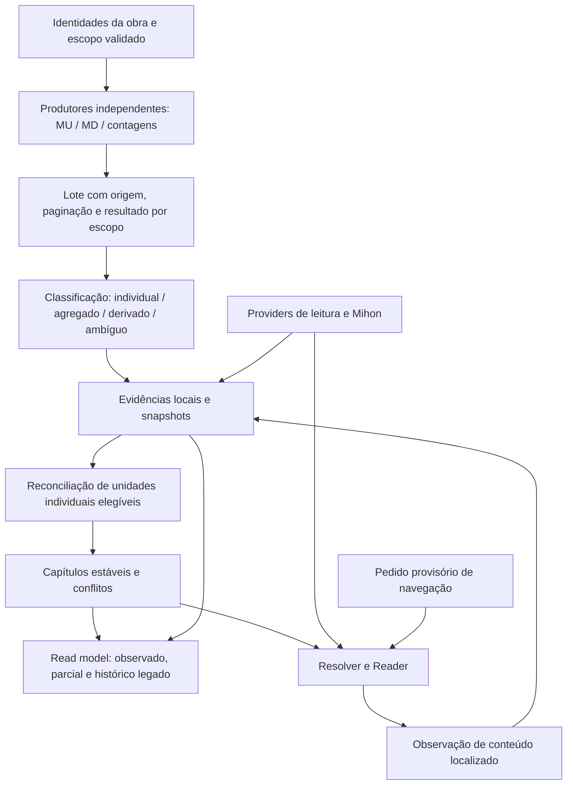

# Relatório C — Validação empírica e viabilidade arquitetural

**Tsuzuki / issue #154 · 24/10/2026 · pesquisa, sem implementação**

**Recomendação:** a Arquitetura A continua sendo a melhor opção, com condições mais restritas de ingestão e uma transição conservadora dos IDs legados. MangaUpdates e MangaDex justificam adapters de **observações de releases**, independentes da capacidade de leitura. Os resultados não justificam promover automaticamente essas observações a uma estrutura editorial completa. Kitsu precisa de tratamento explícito para registros derivados; Bangumi não demonstrou enumeração de capítulos de livros no corpus.

Este documento complementa e preserva o [Relatório A](architecture-research.md). A recomendação anterior é baseline investigativo, não decisão aprovada. A Arquitetura B continua sendo a alternativa de catálogo publicado em pacotes versionados. Não há terceira arquitetura proposta. A decisão pertence ao usuário.

## 1. Escopo, baseline e rastreabilidade

| Item | Estado desta etapa |
|---|---|
| Especificação | [Issue #154](https://github.com/jssantogit/tsuzuki/issues/154); comentários reconsultados, nenhum retornado |
| Código | `main` confirmado em `b0417cdf232e220fe8f7f89f3e156d2d26765883`; tree `a032cbef0149cf62f340063da845ad75d6fc27f3` |
| Baseline documental | Commit `7b996611f086f5214b75eb19ade5cbedcb4abde5` da branch de pesquisa |
| Publicação autorizada | Exclusivamente `docs/issue-154-architecture-research`; sem PR de implementação ou merge |
| Dados do aplicativo | Não abertos, não consultados, não modificados; nenhum banco de produção acessado |
| Execução | Python stdlib, HTTP anônimo de metadados, SQLite `:memory:`, leitura de código/testes/documentação |
| Não executado | Gradle, APK, Android, Reader real, sync remoto, restore real, migração, alteração de comportamento |
| Orchestra | Nenhuma revalidação nesta etapa; o [Relatório B](orchestra-field-validation.md) continua independente e PARTIAL |
| Notion | Nenhuma nova decisão do Notion incorporada nesta etapa; contexto e limitações permanecem os do A |

O trabalho foi feito em uma worktree de publicação já existente. Não houve nova branch de produto, mudança no checkout pessoal ou alteração de código-fonte. Scripts descartáveis e projeções são publicados sob `docs/research/issue-154/evidence-c/`, como documentação de pesquisa.

**Classificação das afirmações:** FATO é observação HTTP, código ou experimento identificado; INFERÊNCIA é interpretação limitada pela amostra; PROPOSTA é contrato futuro, não comportamento implementado; NÃO TESTADO é validação ainda ausente. Os números abaixo são reproduzíveis a partir das projeções, mas não constituem uma auditoria editorial independente de cada capítulo.

### Evidências publicadas

- [Corpus e IDs](evidence-c/corpus.json), [metadados selecionados](evidence-c/selected-metadata.json).
- [48 primeiras páginas](evidence-c/inventory-results.json), [14 followups](evidence-c/followups.json).
- [149 recibos HTTP](evidence-c/requests.jsonl), [estatísticas](evidence-c/summary.json).
- [Experimento SQLite](evidence-c/legacy-sql-results.json), [harness e reprodução](evidence-c/README.md).

Cada recibo registra fonte, método, URL, corpo da busca, instante UTC, status, duração, bytes, hash SHA-256 do corpo original e validadores HTTP quando retornados. As respostas brutas ficam no laboratório temporário local, fora do repositório. Publicamos projeções factuais, sem sinopses completas, imagens, páginas, credenciais ou perfis. O hash não substitui a publicação dos bytes para quem quiser verificar integralmente o corpo original; essa limitação é explícita.

## 2. Método empírico e corpus

Foram feitas buscas de candidatos nas quatro APIs e seleção manual de escopos, seguida de primeira página por identidade fixada. Algumas consultas adicionais verificaram paginação, detalhes, relações e caudas suspeitas. A janela de APIs de metadados foi **18:32:49–18:44:58 UTC de 24/10/2026**. Isso é um retrato de minutos, sem capacidade para medir uptime, atualização após publicação real ou estabilidade longitudinal.

Orçamento: até 160 tentativas totais e 45 por fonte; espera mínima de 1,1s por host; timeout de 20s; resposta limitada a 4 MB; cache local; parada da fonte após 403/429; nenhum retry automático ou contorno de acesso. A medição de duração é HTTP no ambiente observado, não latência de descoberta no aplicativo. Nenhum endpoint de páginas de leitura, imagem ou torrent foi chamado. Não houve varredura de extensões instaladas.

### 2.1. Seleção e limites de representatividade

O corpus é intencional, não aleatório: 12 escopos principais e três contrastes de edição/volume. Inclui mangá, webcomic, manhwa, manhua, novel, one-shot, obras encerradas e em andamento, aliases japoneses/chineses/romanizados, traduções e edição colorida. Não cobre toda a biblioteca do usuário, todo formato nem toda extensão. Os seis refreshes físicos relatados na issue não têm aqui um conjunto identificável de títulos para reprodução; não afirmamos tê-los reproduzido. Death Note, Nanatsu e One Punch-Man cobrem casos históricos identificáveis na auditoria do outline/inventário.

| Escopo | Kitsu | MangaUpdates | Bangumi | MangaDex |
|---|---:|---:|---:|---|
| Death Note, mangá | 57 | 3479935384 | 1674 | `75ee72ab…` |
| Nanatsu no Taizai | 24208 | 62758791984 | 64051 | `e52d9403…` |
| One Punch-Man, remake | 24147 | 30535847369 | 74201 | `d8a959f7…` |
| One Punch-Man, webcomic ONE | 35883 | 37830832998 | não resolvido | `b7d069cb…` |
| Berserk | 8 | 51239621230 | 9640 | `801513ba…` |
| One Piece | 38 | 55099564912 | 3510 | `a1c7c817…` |
| Look Back, Fujimoto | 60475 | 62512335978 | 342254 | `ba7908db…` |
| Solo Leveling, manhwa | 54114 | 15180124327 | 302561 | `32d76d19…` |
| Mo Dao Zu Shi, manhua | 40740 | 34366575338 | 266368 | `6e52262f…` |
| Re:Zero, novel principal | 26776 | 8162824044 | 121927 | não amostrado |
| Re:Zero, mangá arco 1 | 26985 | 11106634916 | não resolvido | `5ef4e73e…` |
| Solanin | 8287 | 21593352517 | 32818 | `a42db50d…` |
| Contraste: Death Note colorido | — | — | — | `85b6f4e4…` |
| Contraste: Solanin nova edição | — | — | 449473 | — |
| Contraste: Re:Zero novel vol. 1 | — | — | 121928 | — |

Os UUIDs integrais e eixos de seleção estão no corpus. `—` significa não amostrado, não ausência da obra. Os 12 escopos por fonte não são exatamente os mesmos: Bangumi inclui os contrastes de Solanin e Re:Zero, enquanto MangaDex inclui Death Note colorido e não inclui a novel. Portanto não cabe um ranking ingênuo de recall entre fontes.

As associações entre catálogos são **candidatos investigativos**, examinados por título, formato, data e links publicados. Não são um crosswalk editorial certificado. MangaDex publica links para outras bases; IDs Kitsu podem vir em forma numérica ou slug, e links MU podem usar slug base36. O código de um adapter deve validar a identidade retornada, não assumir um formato uniforme. A busca de Look Back no MU também devolveu homônimo doujinshi antes da obra desejada. Re:Zero e Solo Leveling distinguem novel de adaptação em quadrinhos. Esses casos tornam inadequada a seleção automática do primeiro resultado textual.

### 2.2. Erros e correções do próprio experimento

1. Dez buscas Kitsu retornaram **406** com `Accept: application/json`. A negociação correta `application/vnd.api+json` retornou 200. A alteração da chave de cache provocou repetição acidental das 30 buscas das demais fontes. Todos os recibos e esse custo permanecem registrados; não chamamos isso de teste planejado de repetibilidade.
2. A busca inicial MangaDex usava safe/suggestive; a inclusão de erotica localizou Berserk. Foi alteração explícita do filtro de **metadados**, sem acesso a conteúdo. Um resultado vazio pode refletir filtro, não inexistência.
3. O ID MU de Re:Zero mangá foi transcrito como `11057030324`. A API respondeu 200 com 10.000 resultados e séries alheias. Essa amostra foi **excluída** e substituída por `11106634916`, obtido de `53olqck` base36 no link publicado. Uma consulta direta confirmou título, tipo Manga, dois volumes completos e latest_chapter 11. Todos os releases válidos passaram na verificação de `metadata.series.series_id` igual ao ID solicitado. Não foi comprovada a regra interna que fez a API ampliar a busca inválida; HTTP 200 sozinho mostrou-se insuficiente para aceitar resultados.

Esses problemas são limites corrigidos do harness, não bugs atribuídos ao Tsuzuki. O `analyze.py` verifica o corpus corrigido e rejeita releases de outra série.

## 3. Resultados observados por fonte

### 3.1. Panorama das primeiras páginas

Notação: `registros retornados / total informado pelo endpoint`. `+` significa que ainda havia próxima página. **Total do endpoint não é contagem de capítulos canônicos.** As paginações adicionais não estão somadas nesta tabela.

| Obra | Kitsu: recursos chapter | MU: releases | BGM: episodes | MD: releases chapter |
|---|---:|---:|---:|---:|
| Death Note | 20/108 + | 25/195 + | 0/0 | 20/20 |
| Nanatsu | 20/346 + | 25/581 + | 0/0 | 4/4 |
| OPM remake | 20/5000 + | 25/410 + | 0/0 | 100/1926 + |
| OPM webcomic | 20/328 + | 25/110 + | — | 54/54 |
| Berserk | 20/5000 + | 25/216 + | 0/0 | 100/4599 + |
| One Piece | 20/5000 + | 25/2307 + | 0/0 | 100/960 + |
| Look Back | 1/1 | 1/1 | 0/0 | 4/4 |
| Solo Leveling | 20/201 + | 25/380 + | 0/0 | 62/62 |
| Mo Dao Zu Shi | 20/259 + | 25/179 + | 0/0 | 100/1024 + |
| Re:Zero novel | 20/5000 + | 25/88 + | 0/0 | — |
| Re:Zero mangá arco 1 | 11/11 | 12/12 | — | 48/48 |
| Solanin | 20/29 + | 12/12 | 0/0 | 100/181 + |
| Death Note colorido | — | — | — | 100/102 + |
| Solanin nova edição | — | — | 0/0 | — |
| Re:Zero novel vol. 1 | — | — | 0/0 | — |

FATO: as 48 consultas válidas de primeira página retornaram HTTP 200. Houve registros em 12/12 escopos Kitsu, 12/12 MU, 12/12 MD e 0/12 BGM. Isso mede **resposta e presença de registros do endpoint**, não inventário editorial utilizável. A cobertura editorial real não foi medida e não pode ser deduzida dessas frações.

### 3.2. Kitsu — IDs individuais com origem potencialmente derivada

Contrato observado: `GET /api/edge/manga/{id}/chapters`, `page[limit]`, `page[offset]`, `meta.count`, `links.next`. As respostas expõem IDs, número, volume, títulos e publicação. Atributos de geração e validação não apareceram. As publicações dos exemplos inspecionados eram nulas; vários títulos estavam vazios ou eram genéricos, como “Chapter 1”. Death Note e One Piece tinham títulos específicos em parte das primeiras linhas.

**FATO:** OPM remake, Berserk, One Piece e Re:Zero novel reportaram 5.000 recursos. Para OPM remake e One Piece, consultas de cauda em offset 4980 retornaram os números **4981–5000**, com IDs reais da API. Não se trata apenas de `meta.count` elevado. OPM webcomic reportou 328 registros, diferente da adaptação remake; formatos não devem ser mesclados.

A explicação estrutural tem evidência no código oficial Kitsu, branch `the-future` observada em `e6575ed9fd73ba8cccb920fe2e3f1ef873a71333`:

- [`Manga`](https://github.com/hummingbird-me/kitsu-server/blob/e6575ed9fd73ba8cccb920fe2e3f1ef873a71333/app/models/manga.rb): limite de progresso padrão 5000, `chapter_count_guess`, callbacks que criam chapters a partir de contagem/estimativa. Mesmo uma contagem declarada pode gerar linhas com status validated.
- [`Chapter.create_defaults`](https://github.com/hummingbird-me/kitsu-server/blob/e6575ed9fd73ba8cccb920fe2e3f1ef873a71333/app/models/chapter.rb): materializa números 1..N com volume 1 e remove números acima da contagem.
- [`LibraryEntry`](https://github.com/hummingbird-me/kitsu-server/blob/e6575ed9fd73ba8cccb920fe2e3f1ef873a71333/app/models/library_entry.rb): progresso pode alimentar a estimativa de unidades, limitado pelo default da mídia.
- [`Unit`](https://github.com/hummingbird-me/kitsu-server/blob/e6575ed9fd73ba8cccb920fe2e3f1ef873a71333/app/models/concerns/unit.rb): distingue autogenerated e validated internamente.
- [`ChapterResource`](https://github.com/hummingbird-me/kitsu-server/blob/e6575ed9fd73ba8cccb920fe2e3f1ef873a71333/app/resources/chapter_resource.rb): não expõe esse status no contrato consultado.

Não foi verificado que o servidor de produção roda exatamente esse commit nem a origem de cada linha observada. A combinação de código e respostas prova que **não é seguro tratar a existência de um recurso Kitsu como prova editorial independente**, nem usar `validated` interno como garantia suficiente. Não prova que todos os registros são falsos. Título específico pode ser enriquecimento válido de uma linha originalmente derivada; não certifica todos os demais números da lista.

Paginação adicional de Solanin retornou números 21–29, completando 29 recursos do endpoint. Isso comprova percurso das duas páginas, não que 29 seja a estrutura de toda edição de Solanin. Sua edição original e nova edição diferem no Bangumi.

**Destino proposto:** manter Kitsu como fonte de contagem, identidade e enriquecimento atribuído. Adapter de enumeração só deve entrar com política que retenha a origem desconhecida/derivada, sem criar 1..N canônicos. Não há, nesta API observada, um filtro comprovado que separe universalmente capítulos editoriais de placeholders. Não priorizar seu adapter como promessa de inventário independente.

### 3.3. MangaUpdates — releases verificáveis, incluindo agregados

Contrato observado: `POST /v1/releases/search` com `search` igual ao ID da série, `search_type: series`, `page`, `perpage`, `include_metadata: true`. Retornou publicamente registros com ID, capítulo em texto, volume em texto, grupos, datas e identidade de série em metadata. Foi exercitada a página 2 de Nanatsu e MDZS. O endpoint de detalhes `GET /v1/series/{id}` também respondeu sem autenticação. Isso não autoriza acesso a operações de usuário.

Resultados decisivos:

| Caso | Observação | Consequência |
|---|---|---|
| Death Note | 195 releases reportados, 25 na página inicial | Não interpretar 195 como capítulos |
| Nanatsu | `346.5`, `328.5`, `293.1`, `327.5` e números repetidos | Preservar decimais exatos e múltiplas manifestações |
| Berserk / Solo Leveling | Mesmo número repetido por release/grupo | IDs de release não são IDs canônicos |
| MDZS | `246-251`, `256-259`, `252-254`, outras faixas | Uma afirmação agregada; não gerar membros individuais |
| Solanin | 12 releases no endpoint inteiro; `18-28`, `15-17`, `10-14`, `2-3`, `1 v2` | Endpoint esgotado continua não sendo lista de 12 capítulos nem prova individual de toda faixa |
| Re:Zero mangá arco 1 | 12 releases; números 1–11 e `1v2` | Revisão de release não exige novo capítulo canônico |
| Look Back | Um release com label `Oneshot` | Não inventar capítulo 1 para obter número |
| Re:Zero novel | Detalhes identificam Novel; release chapter 71 / volume 4, junto a status de dezenas de volumes | Falta provar se a numeração do release é da edição LN, tradução, webnovel ou convenção do grupo |

Em Solanin, o próprio registro de série descreve dois volumes originais e um volume de nova edição. Uma identidade de série pode **englobar edições**. Em Re:Zero, a identificação da obra como novel não resolve a correspondência editorial de seus capítulos. Ambos precisam de escopo/ambiguidade explícitos.

Limite do experimento: não paginamos todas as 2.307 entradas de One Piece, não validamos cada release contra sumário do editor e não aferimos idioma de cada grupo. Quando a resposta não especifica idioma editorial, ele deve permanecer desconhecido. Grupo e data de release não são autor editorial e data de primeira publicação da obra.

**Destino proposto:** adapter independente justificado, com prioridade inicial. Produz observações individuais quando o label é uma unidade inequívoca e o escopo está validado; faixas, volumes e labels ambíguos permanecem afirmações agregadas. Nem a cardinalidade da faixa nem `latest_chapter` autorizam fabricar IDs para seus membros. A validação de `series_id` precisa ocorrer em cada página; o erro de transcrição demonstrou por que isso é obrigatório.

### 3.4. Bangumi — bom contraste de escopos, enumeração de capítulos não demonstrada

Contrato: busca `POST /v0/search/subjects` com filtro de tipo livro, `GET /v0/subjects/{id}`, `GET /v0/episodes?subject_id=...&limit=200&offset=0` e relações `GET /v0/subjects/{id}/subjects`. O uso de aliases nativos resolveu casos que a busca romanizada não selecionava corretamente. O filtro `nsfw: false` limita o universo buscado.

**FATO:** todos os 12 escopos consultados em episodes retornaram `total: 0`, incluindo:

- Death Note, cujo detalhe informa `eps: 108`, volumes 12, série manga.
- Re:Zero novel volume 1, cujo detalhe informa `eps: 5`.
- Look Back, contagem 1; Solo Leveling, 179; MDZS, 259, nos metadados selecionados.

Não houve 401/403 nesses casos: ausência de itens no endpoint público observado, não falha de autenticação demonstrada. Isso não prova que nenhum livro do Bangumi possua episodes, nem que toda essa funcionalidade esteja quebrada. Prova que a hipótese “eps informa capítulos, logo episodes entregará a lista” falha para o corpus.

As relações agregam valor real distinto:

- Solanin retorna seus dois volumes e relação `不同版本` para a nova edição. Metadados distinguem 28 unidades na série original e 29 na nova edição. Não sabemos, sem sumário editorial, como os extras e a edição se alinham.
- Re:Zero novel retorna 80 relações, das quais 46 são marcadas `单行本` (volumes), além de anime, jogos, spin-offs e outras obras. O detalhe de série selecionado informa 44 volumes. A discrepância mostra que contagem e relações também podem divergir. Não concluímos qual afirmação é editorialmente correta.

**Destino proposto:** reutilizar integração para contagens, relações e desambiguação de edição/volume. Não priorizar adapter independente de capítulos de livros. Se no futuro houver corpus com episodes reais, avaliar escopo e qualidade antes de habilitar. IDs de volumes não viram IDs de capítulos.

### 3.5. MangaDex — enumeração real de releases, com cobertura desigual

Contrato observado: `GET /manga/{uuid}/feed`, limit 100, offset, ordenação ascendente por chapter, categorias safe/suggestive/erotica explícitas, `includeFutureUpdates=0`. Não filtramos idioma. As respostas trazem UUID de capítulo/release, número textual, volume textual, título, idioma traduzido, publishAt, updatedAt, version, páginas reportadas e indicador de externalUrl. A ordem por número não define uma ordem estável total entre todos os empates.

| Caso | Evidência | Limite |
|---|---|---|
| Death Note principal | Feed inteiro: 20 releases, 16 labels distintos, idiomas cv/en/es | Não preenche as 108 unidades informadas em outra base |
| Nanatsu | Feed inteiro: quatro releases, números 10, 11, 232, 306 | Lacunas não provam ausência dos demais capítulos |
| OPM webcomic | Feed inteiro: 54 releases, 21 labels distintos | Não fundir com remake; ausência de números anteriores não é inexistência |
| Berserk | Primeira página inclui `0.01`; total de releases 4599 | Decimal textual exato; prefixos históricos não são capítulo zero genérico |
| Look Back | Quatro releases, chapter nulo, quatro idiomas | Uma obra one-shot pode ter unidade sem número |
| Solo Leveling | 62 releases, 25 labels distintos na resposta inteira; capítulo 0 | Não inferir completude pelo endpoint esgotado |
| MDZS | `0`, `000`, números repetidos, volume às vezes nulo e às vezes 1 | Aliases exigem contexto; volume ausente não é volume 1 comprovado |
| Re:Zero mangá arco 1 | 48 releases, 12 labels distintos; volume presente em parte | `1v2` do MU precisa ser interpretado como revisão, não comparação textual cega |
| Solanin | Segunda página completou 181 releases | Completo no endpoint, sem certificação de equivalência de edições |
| Death Note colorido | Página 2 devolveu os dois releases restantes de 102 | Edição colorida tem identidade própria; não unir por título base |

“Labels distintos” aqui é só cardinalidade de strings de chapter, calculada sem reconciliação: agrupa labels nulos e ignora volume. Não é número de capítulos editoriais nem métrica confiável de cobertura. Foi usada para expor a diferença entre releases e unidades, não para aprovar deduplicação.

Há releases com `externalUrl` e `pages: 0`. Eles são evidência de registro/manifestação, não comprovação de conteúdo entregável pelo Tsuzuki. Não foram seguidos links externos nem requisitados manifests de páginas. Idiomas observados incluem en, pt-br, es, es-la, id, zh-hk e vários outros conforme a resposta; a lista concreta por linha está na evidência, sem promessa de cobertura por idioma original.

**Destino proposto:** adapter independente tecnicamente justificado, opcional, de metadados de releases. Um serviço que também hospeda leitura pode contribuir para inventário sem ser requisito para Reader e sem exigir `reading.pages`. A entrada deve conservar procedência e classificação de evidência de release; desligar/substituir o provider de leitura não apaga essa evidência. Evitar dupla contagem quando um addon e o adapter descrevem o mesmo release.

## 4. Custo, limites, termos e alternativas

### 4.1. Custo observado e custo esperado de paginação

Estatísticas incluem buscas, repetições acidentais, detalhes, consultas excluídas e followups; não são um benchmark dos adapters futuros.

| Fonte | Tentativas | HTTP 200 / outros | Bytes recebidos | Mediana HTTP dos 200 |
|---|---:|---|---:|---:|
| Kitsu | 35 | 25 / dez 406 | 494.779 | 562 ms |
| MU | 40 | 40 / zero | 942.722 | 1.140,5 ms |
| BGM | 39 | 39 / zero | 438.524 | 360 ms |
| MD | 35 | 35 / zero | 1.411.741 | 984 ms |

Não houve 429/403 nas consultas de dados. Isso não mede quota disponível nem resiliência a throttling. Não se contabilizam aqui leituras GitHub e páginas de documentação. O total de corpos de dados foi cerca de 3,29 MB, com 149 tentativas. Memória, bateria, custo de rede móvel e latência Android não foram medidos.

Com a paginação **usada**, varrer 5000 registros Kitsu exigiria 250 páginas de 20; Berserk MD, cerca de 46 páginas de 100; One Piece MU, cerca de 93 páginas de 25. São estimativas aritméticas sobre totais retornados, não varreduras executadas ou tamanhos máximos impostos pela API. Os totais podem mudar durante a varredura. O custo torna inadequado buscar tudo novamente a cada abertura de título.

### 4.2. Contratos operacionais e de uso

| Fonte | Contrato confirmado / restrição | Lacuna e consequência |
|---|---|---|
| Kitsu | API JSON:API pública e código oficial inspecionado; resposta exigiu Accept adequado | Documentação Apiary não ficou utilizável nesta sessão; página de termos retornou shell HTML, sem texto suficiente para certificar licença/quota. Não inferir licença de dados da licença do servidor |
| MU | [API/AUP oficial](https://mangaupdates.apidocumentation.com/): atribuição, espaçamento e cache; serviço/dados sem garantia | Não foi confirmada quota numérica fixa. Respeitar 429/Retry-After e termos correntes; `perpage: 8` em busca de séries retornou 25 no observado, então não assumir tamanho solicitado sem conferir resposta |
| BGM | [Documentação pública](https://github.com/bangumi/api), [separação API pública/privada](https://github.com/bangumi/dev-docs); [termos/copyright](https://bangumi.tv/about/copyright) autorizam API/arquivos e exigem respeito à licença e limites | Há cláusulas de restrição/revogação e eliminação de dados após encerramento do serviço. Retenção técnica em falha transitória não pode ser confundida com direito irrestrito de redistribuir/cachear. Quota numérica não certificada |
| MD | [Limitações oficiais](https://api.mangadex.org/docs/2-limitations/): User-Agent identificável e limite global aproximado de 5 req/s/IP; [OpenAPI](https://api.mangadex.org/docs/static/api.yaml) | Acesso público não é licença irrestrita. Confirmar condições aplicáveis à distribuição, atribuição e remoção antes da ativação; não inferir permissão de leitura pelo metadado |

Os documentos foram consultados em 24/10/2026. O texto BGM declara licença BY-SA para informações de catálogo e obrigações adicionais de uso da plataforma; isso demanda estratégia de atribuição e separação dos dados. Não houve avaliação jurídica nem aprovação de redistribuição de um catálogo completo. A Arquitetura B tem exposição operacional e de redistribuição maior que caches locais A. Uma remoção exigida por termos deve poder remover o payload e reter somente o estado mínimo do usuário permitido, sem continuar apresentando a fonte como evidência disponível.

Manutenção: Kitsu tem implementação pública inspecionável, mas contratos REST omitem a proveniência necessária; BGM mantém API v0 pública separada da API privada em desenvolvimento; MU documenta a API que serve o próprio site; MD mantém documentação e OpenAPI públicos. Existência de código/docs e HTTP 200 hoje não certificam SLA, continuidade da equipe ou estabilidade futura. Adapters precisam de contrato testado, versionamento e desligamento independente.

### 4.3. Outras fontes consideradas

| Fonte | Avaliação desta etapa | Decisão investigativa |
|---|---|---|
| AniList / MAL existentes | [AniList Media.chapters](https://docs.anilist.co/reference/object/media) descreve uma contagem, não enumeração de capítulos. MAL continua útil conforme auditoria do A | Preservar contagens/metadados; não usar para preencher lacunas |
| Open Library | [API oficial](https://openlibrary.org/dev/docs/api/books) distingue work/edition, ISBN e sumário opcional `table_of_contents` | Candidato para novels por edição, com numeração e identidade editorial a validar. Nenhuma consulta de corpus realizada; não prometer cobertura |
| Google Books | [Volume resource](https://developers.google.com/books/docs/v1/reference/volumes) oferece volume, idioma, ISBN/publicação e páginas; não documenta lista estruturada de capítulos nesse recurso | Útil para identidade de edição, sem justificativa atual de adapter de inventário |
| MangaBaka | [API e política oficiais](https://mangabaka.org/data/api): agrega metadados de upstreams, atualização periódica, schema ainda sem estabilidade 1.0, licenças e atribuição próprias e dos upstreams | Pode ajudar crosswalk/cache; não encontramos nessa documentação prova de inventário editorial individual independente. Não chamar duas cópias do mesmo upstream de corroboração independente |
| Catálogos/sumários de editoras | Potencial para prova editorial específica por edição | Não foi comprovada uma API uniforme ou licença para ingestão geral; validação direcionada futura, sem scraping indiscriminado |
| Nyaa/P2P, extensões de leitura | Não exercitados; capabilities e separação analisadas no A | Continuam complementares para disponibilidade; sem relaxar matching para fabricar inventário |

Não acrescentamos dependência obrigatória nova. Não foram feitas consultas reais a essas alternativas adicionais; são triagem documental, não cobertura medida. Open Library merece um próximo corpus de ISBN/sumários se novels forem prioridade, mas não bloqueia o caminho inicial MU/MD.

## 5. O que muda na hipótese arquitetural

O Relatório A já alertava para Kitsu derivado e MU agregado. Agora há observações concretas que restringem a solução:

1. **Existência de linha externa e existência editorial são afirmações diferentes.** Kitsu pode ter 5000 IDs; MU pode ter um ID para `18-28`; MD pode ter dezenas de IDs para um número. Um reconciliador genérico de números não resolve essas semânticas sozinho.
2. **“Integração” não significa “editorial”.** O tipo de produtor registra a via de coleta; a autoridade precisa decorrer da afirmação e de sua origem. MU/MD são observações de releases; origem Kitsu pode ser derivada. A evidência não deve ganhar CONFIRMED só porque entrou pelo registry de integrações.
3. **Completude do transporte não é completude editorial.** `hasNext=false` significa apenas que a consulta/escopo acabou. Death Note MD e Re:Zero volume BGM deixam essa diferença visível.
4. **Idioma de release não define sozinho edição canônica.** Traduções podem dividir/agrupar capítulos; volume ausente não é um valor default confiável.
5. **Concordância precisa de independência de origem.** MU e MD podem referir o mesmo lançamento externo, por exemplo MANGA Plus. Duas APIs não constituem automaticamente duas testemunhas independentes.

**Menor objetivo sólido:** inventário local de afirmações atribuídas, capaz de mostrar unidades observadas e incerteza, sem exigir leitura instalada. Não é entregar universalmente uma lista completa.

## 6. Rastreio dos IDs legados `tsuzuki:count:*`

Todos os links de código deste relatório são fixados no baseline `b0417cdf…`. Os testes foram **lidos, não executados**. O experimento SQL da seção 7 é separado dessa revisão Kotlin.

### 6.1. Nascimento, materialização e promoção

[`BuildCanonicalChapterOutline`](https://github.com/jssantogit/tsuzuki/blob/b0417cdf232e220fe8f7f89f3e156d2d26765883/domain/src/main/java/tachiyomi/domain/tsuzuki/chapter/interactor/BuildCanonicalChapterOutline.kt) gera slots de contagem e IDs determinísticos `tsuzuki:count:<title>:<n>`. A função `isInferredChapter` verifica forma/identidade numérica e ID; **não consulta evidência, confiança ou estado de confirmação**.

[`MaterializeInferredChapter`](https://github.com/jssantogit/tsuzuki/blob/b0417cdf232e220fe8f7f89f3e156d2d26765883/domain/src/main/java/tachiyomi/domain/tsuzuki/chapter/interactor/MaterializeInferredChapter.kt) persiste o slot quando uma ação precisa de capítulo. Reutiliza identidade única existente, rejeita ambiguidade e protege numeração local a volumes. Não é apenas um ID transitório de UI.

[`MaterializeInferredChapterTest`](https://github.com/jssantogit/tsuzuki/blob/b0417cdf232e220fe8f7f89f3e156d2d26765883/domain/src/test/java/tachiyomi/domain/tsuzuki/chapter/interactor/MaterializeInferredChapterTest.kt) descreve:

- 20 ações concorrentes criando um único ID;
- evidência real posterior promovendo confiança e mantendo **o mesmo count ID**;
- reutilização de capítulo já observado para preservar chave de progresso;
- rejeição quando o mesmo número existe em volumes distintos.

Consequência: o prefixo é **linhagem de criação**, não um estado atual de conhecimento. Um `count:*` pode ser corroborado e ter ações reais. Inversamente, confidence baixa não garante que o resolver o recusará: há exceção explícita para esse tipo de ID.

### 6.2. Visibilidade, leitura e download

O [screen model de título](https://github.com/jssantogit/tsuzuki/blob/b0417cdf232e220fe8f7f89f3e156d2d26765883/app/src/main/java/eu/kanade/tachiyomi/ui/tsuzuki/detail/CanonicalTitleScreenModel.kt) usa materialização antes de abrir capítulo e solicitar download. O fluxo Home/OpenCanonicalChapter também usa o outline/materializador. Portanto uma tentativa que falhe ao encontrar conteúdo pode deixar capítulo persistido, ainda sem progresso ou download. Ausência de progresso não é prova de que nunca houve intenção do usuário.

No screen model, o indicador inferred pode continuar associado quando o materializador devolve o mesmo ID. Uma futura classificação de UI não deve repetir a regra de prefixo como diagnóstico epistemológico.

[`MihonContentProvider`](https://github.com/jssantogit/tsuzuki/blob/b0417cdf232e220fe8f7f89f3e156d2d26765883/app/src/main/java/eu/kanade/tachiyomi/data/tsuzuki/addon/MihonContentProvider.kt) permite fallback por identidade para capítulo específico, numerado e não conflitado quando há confiança suficiente **ou** `isInferredChapter`. Ainda requer vínculo confiável da obra. Remover o count outline sem um substituto pode reduzir a capacidade de solicitar um capítulo; apenas baixar confiança dos legados não remove essa exceção. Nenhum teste físico dessa transição foi executado.

### 6.3. Persistência e referências

| Referência | Vínculo atual | Risco de apagar capítulo |
|---|---|---|
| `tsuzuki_chapter_progress` | FK chapter CASCADE; last_variant SET NULL | Perda de posição/read |
| `tsuzuki_chapter_history` | FK chapter CASCADE | Perda de histórico/duração |
| `tsuzuki_canonical_downloads` | FK chapter CASCADE | Perda do vínculo de arquivo local; SQL não prova exclusão física do arquivo |
| `tsuzuki_chapter_update_state` | FK chapter/title CASCADE | Perda de first-seen/ack |
| `tsuzuki_mihon_projection_queue` | FK chapter CASCADE | Perda de projeção pendente para Mihon |
| `tsuzuki_chapter_variants` | FK chapter CASCADE | Perda de identidade operacional/vínculos de fonte |
| `tsuzuki_chapter_evidence` | mapped chapter SET NULL | Evidência permanece, mas perde associação |
| `tsuzuki_chapter_overrides` | Chave portátil em texto; sem FK chapter | Pode sobreviver com referência semântica que precisa ser interpretada |

Fonte: [DDL canônico](https://github.com/jssantogit/tsuzuki/tree/b0417cdf232e220fe8f7f89f3e156d2d26765883/data/src/main/sqldelight/tachiyomi/data), arquivos individuais registrados com hashes no experimento. `countTsuzukiCanonicalChapterProtectedState` soma progresso, histórico, download, update state e projection queue. Não é um inventário completo de toda referência semântica: variantes/evidências têm tratamento próprio e overrides precisam de auditoria de chave.

[`CanonicalChapterRepositoryImpl.consolidateExactDuplicateIfSafe`](https://github.com/jssantogit/tsuzuki/blob/b0417cdf232e220fe8f7f89f3e156d2d26765883/data/src/main/java/tachiyomi/data/tsuzuki/CanonicalChapterRepositoryImpl.kt) verifica identidade/volume e estado protegido antes de reatribuir evidências/variantes e remover duplicado em transação. Se os dois lados tiverem estado protegido, a consolidação não está automaticamente resolvida. Não ampliar esse guard para “limpar prefixos”.

### 6.4. Progresso portátil e sync

[`CanonicalChapterSyncKey`](https://github.com/jssantogit/tsuzuki/blob/b0417cdf232e220fe8f7f89f3e156d2d26765883/domain/src/main/java/tachiyomi/domain/tsuzuki/sync/model/CanonicalChapterSyncKey.kt) pode gerar chave v1 por identidade numerada sem verificar origem count, confirmação ou evidência. Volume não compõe essa chave v1; há guardas contra ambiguidade. Capítulos com `numberingKind` exato ficam fora desse caminho legado.

O [adapter de progresso](https://github.com/jssantogit/tsuzuki/blob/b0417cdf232e220fe8f7f89f3e156d2d26765883/domain/src/main/java/tachiyomi/domain/tsuzuki/sync/adapter/CanonicalReadingProgressSyncAdapter.kt) exporta registros elegíveis e resolve import por identidade local única; não cria capítulo ausente. Assim, um capítulo count numerado com progresso **pode já ter sido exportado**. É uma possibilidade comprovada pelo caminho de código, não constatação sobre uma conta real.

Em [`SupabaseSyncOrchestrator.materializeLocalTombstones`](https://github.com/jssantogit/tsuzuki/blob/b0417cdf232e220fe8f7f89f3e156d2d26765883/domain/src/main/java/tachiyomi/domain/tsuzuki/sync/service/SupabaseSyncOrchestrator.kt), registros presentes no accepted base e ausentes no export local viram tombstones `local-delete` quando schema/kind são compatíveis. Isso ocorre em caminhos usados pelo orchestrator. **Filtrar count IDs do export pode representar uma exclusão remota**, mesmo sem executar DELETE local. Não foi feito sync remoto para observar propagação; esse efeito é risco concreto sustentado pela implementação, não incidente medido.

Os [testes do adapter](https://github.com/jssantogit/tsuzuki/blob/b0417cdf232e220fe8f7f89f3e156d2d26765883/domain/src/test/java/tachiyomi/domain/tsuzuki/sync/adapter/CanonicalReadingProgressSyncAdapterTest.kt) cobrem portabilidade, identidades não portáveis e volumes ambíguos. Não são testes executados desta migração, que ainda não existe.

### 6.5. Backup e restore

O core de backup canônico exporta capítulos/IDs/evidências/estado sem política geral de excluir count prefix. Import exige referências consistentes. Entretanto o rollout continua deliberadamente separado: o `.tachibk` de produção não é uma cópia completa do grafo canônico, e a restauração de snapshot canônico declarado permanece bloqueada no caminho de produção descrito no [contrato de rollout](https://github.com/jssantogit/tsuzuki/blob/b0417cdf232e220fe8f7f89f3e156d2d26765883/docs/tsuzuki/canonical-backup-rollout.md).

Logo, não é seguro justificar uma limpeza com “o usuário pode restaurar o backup”. Manter estado local durável e uma estratégia explícita de reversão é obrigatório. Ativar backup/progresso exato de #140 para facilitar esta issue seria ampliação de escopo e não foi proposto como atalho.

## 7. Experimento descartável de integridade referencial

O [script](evidence-c/legacy_sql_probe.py) lê as definições CREATE TABLE de **nove arquivos reais** do baseline, remove somente anotações SQLDelight de tipo e cria banco SQLite **em memória**, com FK habilitada. Duas tabelas pais são stubs mínimos de IDs. Não usa banco do app, ORM, adapters Kotlin, triggers, índices, Reader, sync remoto ou o pipeline de migração Android.

Fixture sintética: título de teste, capítulo `tsuzuki:count:fixture-title:37`, uma variante, progresso, histórico, download, update state, projection queue, evidência mapeada e override. Não representa dados de usuário.

| Verificação executada | Resultado |
|---|---|
| Consulta real de protectedState | 5 referências protegidas na fixture |
| UPDATE de confidence/confirmation mantendo ID | Todas as referências e contagens preservadas |
| DELETE hipotético sob savepoint | Capítulo, variante e cinco tabelas dependentes zerados |
| Evidência após DELETE | Linha mantida, mapped chapter nulo |
| Override após DELETE | Linha mantida, chave semântica mantida |
| ROLLBACK TO savepoint | Todas as linhas preservadas/restauradas |

SQLite utilizado: 3.49.1. Assertions passaram; hashes dos arquivos e contagens estão no [resultado](evidence-c/legacy-sql-results.json). Isso valida a semântica de FK nessa reprodução reduzida e demonstra por que a atualização mantendo ID é menos destrutiva. **Não valida uma migração do aplicativo**, a guarda Kotlin de consolidação ou recuperação de arquivos de downloads. O rollback do savepoint não é evidência de rollback de uma release.

Não foi executado um reconciliador alternativo, parser futuro ou fixture apresentada como teste do produto. Os exemplos 120/80 e falhas abaixo são critérios propostos, não resultados experimentais.

## 8. Transição segura: parar de fabricar entidades sem perder ações

**PROPOSTA, pendente de aprovação.** A mudança precisa separar três objetos: contagem informativa, pedido de navegação e capítulo conhecido. O problema atual não se resolve apagando entidades antigas.

### 8.1. Política por classe de legado

| Classe encontrada por diagnóstico futuro | Tratamento recomendado |
|---|---|
| Slot virtual ainda não persistido | Deixar de tratá-lo como capítulo confirmado; manter contagem informativa |
| Count ID persistido com evidência válida | Preservar ID e todos os vínculos; classificar pela evidência atual, não pelo prefixo |
| Count ID com progresso, histórico, download, fila ou outra referência de usuário | Preservar integralmente; representar como registro histórico de identidade ainda não corroborada quando necessário |
| Count ID sem referências protegidas e sem evidência | Conservar inicialmente como legado não resolvido; não assumir ausência de intenção só porque uma tentativa não gerou progresso |
| Duplicado novo e legado com identidade comprovadamente igual | Preferir ID existente; usar guardas transacionais já existentes quando realmente seguras |
| Dois IDs com estado protegido ou identidade/volume/edição divergente | Não fundir automaticamente; manter conflito e mapa de aliases apenas quando comprovado |
| Chave portátil já sincronizada | Preservar export/accepted base até protocolo de compatibilidade deliberado; nenhum filtro que emita tombstone implícito |

O primeiro rollout deve ser **aditivo, sem garbage collection** de count IDs. A prevalência das classes é desconhecida: não abrimos a base de nenhum usuário. Antes de migração, um diagnóstico local opt-in pode contar classes e referências sem transmitir biblioteca ou títulos. Esse diagnóstico ainda precisa ser implementado em trabalho aprovado.

Manter IDs não equivale a manter a afirmação de que os capítulos existem editorialmente. A UI pode separar “Capítulos observados” e “Registros anteriores”, preservando continuar leitura/download e marcando a incerteza. Um capítulo historicamente lido tem evidência de ação do usuário, mas isso não resolve automaticamente a identidade editorial da edição.

### 8.2. Contagens e navegação provisória

As tabelas/contratos de reported counts podem continuar a exibir “Fonte X informa 120; 80 unidades identificadas; inventário parcial”. Não gerar 40 linhas, IDs, alertas de novos capítulos ou downloads em lote para as lacunas.

Um controle explícito “Procurar capítulo…” pode aceitar número/volume/edição como **pedido transitório de resolução**, sem inserir capítulo canônico para poder chamar um resolver. O pedido contém contexto de título confiável e a intenção do usuário; só produz entidade quando há evidência individual suficiente e matching seguro. Sem resultado, conserva-se no máximo intenção/histórico de busca conforme política aprovada, não prova de capítulo. Esse pedido é uma evolução futura do contrato do resolver; não cabe simplesmente reutilizar um ID falso.

Para count IDs já usados, manter um caminho compatível de resolução, com classificação histórica e contexto, até o novo pedido substituir as ações. Não trocar silenciosamente o comportamento dos botões Home/Reader/download. Navegação sequencial continua sobre unidades conhecidas e variantes válidas; a contagem pode oferecer busca, não definir “próximo capítulo existente”. Nenhuma exceção para Nyaa ou matching frouxo.

### 8.3. Ordem de transição e rollback

1. Diagnóstico e contrato de compatibilidade: inventariar referências, chaves sync e proteção de backup, sem mutação.
2. Read model aditivo: suporte atual e linhagem separados; count IDs continuam íntegros.
3. Ingestão em modo sombra: comparar MU/MD com dados atuais, sem substituir identidade nem emitir updates/downloads.
4. Novo pedido de resolução e UI parcial sob rollout controlado; bloquear materialização **nova** por contagem somente depois de preservar as ações equivalentes.
5. Reconciliar com preferência por IDs existentes; migração versionada só se necessária e aprovada. Não reaproveitar números entre edições por default.
6. Avaliar qualquer limpeza em tarefa separada, após retenção, sync/restore e experiência manual comprovados. A arquitetura não depende dessa limpeza.

Rollback inicial: desligar novos produtores/read model e voltar aos caminhos antigos sem apagar tabelas/IDs/referências. Não rebaixar banco nem apagar observações para “voltar”. Se novos estados entrarem no sync/backup, rollback passa a depender de compatibilidade desses formatos; por isso a primeira fase não deve alterar seus exports. Novas evidências devem ser reconstruíveis por fonte ou explicitamente protegidas antes de serem únicas portadoras de informação do usuário.

## 9. Viabilidade da Arquitetura A no código atual

### 9.1. Componentes reutilizáveis e limites reais

| Componente atual | Reuso | Evolução necessária |
|---|---|---|
| [`ChapterEvidenceProvider`](https://github.com/jssantogit/tsuzuki/blob/b0417cdf232e220fe8f7f89f3e156d2d26765883/domain/src/main/java/tachiyomi/domain/tsuzuki/integration/IntegrationCapabilities.kt) | Fronteira de integração já separada de ContentProvider | `Result<List<ChapterEvidence>>` não representa paginação parcial, count, escopo, falha por página ou snapshot completo |
| [`DefaultIntegrationRegistry`](https://github.com/jssantogit/tsuzuki/blob/b0417cdf232e220fe8f7f89f3e156d2d26765883/app/src/main/java/eu/kanade/tachiyomi/data/tsuzuki/integration/DefaultIntegrationRegistry.kt) | Registro/habilitação de produtores | Hoje usa chave `chapter_evidence`; precisa contrato/política explícitos para enumeração sem leitura e consentimento/termos aplicáveis |
| [`RefreshChapterEvidence`](https://github.com/jssantogit/tsuzuki/blob/b0417cdf232e220fe8f7f89f3e156d2d26765883/domain/src/main/java/tachiyomi/domain/tsuzuki/chapter/evidence/RefreshChapterEvidence.kt) | Orquestração de produtores, refresh e persistência | Isolar resultado por escopo/fonte; evitar vazio destrutivo e checkpoint prematuro de página |
| [`ChapterEvidence`](https://github.com/jssantogit/tsuzuki/blob/b0417cdf232e220fe8f7f89f3e156d2d26765883/domain/src/main/java/tachiyomi/domain/tsuzuki/chapter/evidence/ChapterEvidence.kt) / persistência | Produtor, ID externo, label, volume, tempo e associação já existem | Não há representação suficiente de geração derivada, agregado, idioma/edição e cobertura de coleta no contrato básico |
| [`ReconcileChapterEvidence`](https://github.com/jssantogit/tsuzuki/blob/b0417cdf232e220fe8f7f89f3e156d2d26765883/domain/src/main/java/tachiyomi/domain/tsuzuki/chapter/evidence/ReconcileChapterEvidence.kt) | Matching, preservação de identidade, conflito e transação | `EDITORIAL` pode confirmar; não atribuir essa autoridade automaticamente aos adapters novos. Agregados/derivados não entram como candidatos individuais |
| Reported counts | Contagens independentes já têm lugar próprio | Exibir denominador por escopo/fonte; não alimentá-las de volta em geração 1..N |
| Refresh snapshots/fingerprints | Reutilizar infraestrutura local de escopo/configuração | `itemCount` e hash não representam qualidade/completude; distinguir tentativa, sucesso parcial e snapshot exaurido |
| Repositórios SQLDelight / gate de mutação | Unidade transacional e guardas existentes | Persistência aditiva e codecs versionados para as novas dimensões; não despejar JSON opaco incompatível com backup |
| Identidade exata, overrides, resolver, Mihon | Preservar contratos e mecanismos atuais | Pedido provisório sem entidade falsa, suporte do legado, nenhuma liberação automática de progresso v2 |

[`RefreshCanonicalChapters`](https://github.com/jssantogit/tsuzuki/blob/b0417cdf232e220fe8f7f89f3e156d2d26765883/domain/src/main/java/tachiyomi/domain/tsuzuki/chapter/interactor/RefreshCanonicalChapters.kt) continua sendo caminho de compatibilidade para mappings Mihon materializados: busca inventários e reconcilia em lote. Não é preciso transformá-lo no proprietário de toda descoberta externa ou obrigar adapters bibliográficos a criar SourceTitleMappings de leitura.

### 9.2. Fluxo proposto



Os nomes descrevem responsabilidades propostas, não novas classes aprovadas. Domain decide identidade/eligibilidade/qualidade; Data implementa HTTP/cache/SQLDelight; UI comunica resultado. Registry de leitura não deve decidir se uma fonte bibliográfica pode contribuir. O provider mantém variantes e entrega páginas; o adapter de inventário não precisa oferecer páginas.

### 9.3. Lote mínimo e persistência

O contrato evoluído deve carregar, conceitualmente:

- Identidade externa da obra validada, edição/idioma/volume quando conhecidos; desconhecido não vira wildcard positivo.
- Produtor e origem primária quando rastreável; ID/URL da afirmação, label original, instante observado e versão externa.
- Tipo de afirmação: unidade individual, release agregado, contagem declarada, registro derivado ou ambíguo.
- Resultado da coleta: não tentada, sucesso parcial com cursor, exaurida no escopo, falha/restrição; filtros e fingerprint de configuração.
- Dados individuais elegíveis separados das afirmações que não podem materializar capítulos.

Não pressupõe uma coluna por dimensão nem um event store universal. Número, volume e proveniência por item podem aproveitar os modelos existentes; estado da coleta e escopo merecem persistência própria ou extensão tipada de snapshots. O detalhamento SQL e codecs é decisão de implementação futura, condicionado a backup e compatibilidade. O índice único atual `(producer_kind, producer_id, external_chapter_key)` exige chaves realmente únicas por produtor: um ID de release global é adequado; “capítulo 1” ou ordinal de página não é.

**Incrementalidade:** buscar últimas alterações quando suportadas, sobrepor uma janela para desempatar/absorver correções, fazer upsert por ID externo e não por posição. Página recebida pode enriquecer evidência, mas não autoriza eliminar ausentes ou declarar escopo completo. Só completar snapshot após todas as páginas necessárias, com cursor e filtros persistidos. Offset pode se deslocar durante coleta: deduplicar IDs e repetir janela limitada; ainda pode ser necessário revalidar periodicamente o escopo.

No MD, `updatedAt/version` ajudam a detectar correção; `publishAt` não é garantia de capturar toda correção antiga. MU tem release date e metadados, sem changefeed editorial certificado aqui. Kitsu pode remover defaults ao alterar contagem; não replicar isso como DELETE canônico. Retirada explícita e revalidação negativa podem diminuir suporte/freshness, mas preservam identidade e estado do usuário. Falha, timeout, desabilitação, HTTP vazio e remoção exigida por termos são eventos diferentes.

Concorrência: coleta fora da transação, commit curto por fonte/escopo, gate atual para mutação canônica, coalescência e geração de refresh para rejeitar resposta velha após configuração nova. Resultado lento de um adapter não deve impedir mostrar cache nem sucesso dos demais. Retry futuro apenas limitado, com backoff/jitter e Retry-After; não executar tempestade de requisições para recuperar cobertura.

### 9.4. Qualidade, cobertura e UX

| Dimensão | Representação recomendada |
|---|---|
| Proveniência | Claim ligado a fonte/ID/escopo/tempo e origem upstream quando conhecida |
| Confiança | Classes justificáveis de suporte, sem score decimal universal inventado |
| Cobertura de coleta | Página parcial ou consulta exaurida com filtros; separada de cobertura da obra |
| Cobertura editorial | Quantidade de unidades individualmente elegíveis dentro de escopo; razão só se denominador comparável e confiável |
| Completude | Indeterminada, parcial, ou justificada num escopo/instante; “em andamento” não possui completude futura |
| Concordância | Compatível, divergente ou não comparável; contar origens independentes, não apenas APIs |
| Atualidade | Observado/revalidado/tentativa mais recente separados; manter último sucesso no offline |

120 versus 80: se a contagem de 120 e as 80 unidades forem da mesma edição/escopo, exibir “80 identificados; fonte X informa 120; parcial”. 80/120 = 66,7% pode ser mostrado **como relação aos dados daquela fonte**, nunca como precisão editorial comprovada. Se os escopos divergem ou a contagem é duvidosa, nem a razão deve ser calculada. Os 40 restantes não ganham IDs, posição canônica nem prova de ausência. Uma faixa MU `81-120` continua uma afirmação agregada e não preenche as 40 unidades individualmente.

UI inicial: resumo curto, indicação “parcial” e acesso opcional à origem/última atualização. Item conflitado mantém acesso às manifestações sem escolher identidade silenciosamente. Em ausência de fonte enumerável: contagem informativa e busca explícita, sem lista falsa. Sem provider: lista observada continua visível e pode informar indisponibilidade para leitura. Offline: cache atribuído com data, downloads existentes acessíveis, nenhuma afirmação de atualização.

## 10. Comparação atualizada: A e B

**A — inventário local de evidências:** o dispositivo coleta afirmações por título e mantém o conhecimento reconciliado. É a evolução das fronteiras já presentes.

**B — catálogo independente publicado em pacotes versionados:** um processo externo coleta/curadoria, publica snapshots/deltas e o app consome versões verificáveis, preservando estado do usuário separado do catálogo. Continua sendo alternativa completa do Relatório A, sem implementação nesta etapa.

| Critério | A, à luz dos resultados | B, à luz dos resultados |
|---|---|---|
| Independência de leitura | Forte, se capability de enumeração for independente | Forte, catálogo chega sem provider |
| Qualidade de fontes | Continua limitada; precisa classificador e escopo local | Mesmas fontes limitadas; centralização não corrige 5000 placeholders ou faixas |
| Curadoria editorial | Mais difícil de distribuir; pode consumir decisões específicas | Melhor espaço para curadoria/crosswalk compartilhados, mas requer operação real |
| Reuso do Tsuzuki | Alto: providers de evidência, repos, reconciliação, counts | Médio: importador/pacotes, distribuição e vínculo de catálogo a IDs locais novos |
| Cobertura sem fonte enumerável | Não promete lista | Também não promete, salvo curadoria externa efetivamente feita |
| Proveniência e incompletude | Claim e snapshot locais, por escopo | Precisam viajar no pacote; uma versão não é selo de completude |
| Latência | Rede por título; cache imediato e ingestão incremental | Download de pacote pode ser rápido no app, mas com atraso do pipeline |
| Recursos/custo | Mais consultas distribuídas; minimizar páginas e cachear | Menos consultas repetidas nos aparelhos; custo de servidor, armazenamento e distribuição |
| Offline | Cache do que foi observado e estado local | Catálogo empacotado pode cobrir mais títulos de saída |
| Migração do count legado | Preserva IDs e reconcilia incrementalmente | Também exige preservar IDs, progresso e aliases; ID de catálogo não substitui legado diretamente |
| Sync/backup | Melhor manter formatos atuais inicialmente | Compatibilidade de versão/catálogo adiciona dependência ao restore e sync |
| Conflitos e correções | Podem divergir entre dispositivos até revalidação | Versão comum facilita diagnóstico; erro de pacote atinge muitos clientes |
| Resiliência | Falha isolada por fonte; último conhecimento retido | Pipeline/host de pacotes vira dependência adicional, mitigada com último pacote |
| Termos e redistribuição | Uso local/cache ainda precisa cumprir termos | Redistribuição sistemática e derivados exigem validação mais ampla |
| Manutenção | Adapters e contratos no app | Adapters + pipeline + curadoria + protocolo de atualização/distribuição |
| Sustentabilidade inicial | Melhor adequação ao código e escopo atual | Só justificável com serviço/curadoria e direitos de dados sustentáveis |

**Recomendação mantida, mas mais estreita:** aprovar A como direção, começar por MU/MD em modo sombra e legados preservados. Não aprovar promessa de cobertura universal, adoção indiscriminada de Kitsu ou export de novos formatos. A principal fragilidade de A é a qualidade/escopo do upstream e o custo de consultas repetidas, não uma ausência completa de infra local.

B passaria a ser preferível se medições futuras demonstrarem curadoria compartilhada indispensável, custo distribuído excessivo ou necessidade de catálogo offline amplo, **e** houver operação e permissão de distribuição sustentáveis. Os resultados de hoje não provam essas condições. Consumir curadoria futura não exige reescrever o Reader; pode ser evolução posterior das entradas de evidência, mantendo a comparação original.

## 11. Cenários de aceitação e experimentos ainda necessários

Esta tabela define comportamento esperado. Apenas os casos com evidência citada foram exercitados parcialmente; não há testes executados das arquiteturas futuras.

| Cenário | A | B | Evidência atual / teste faltante |
|---|---|---|---|
| Zero providers de leitura | Coleta independente ou cache | Importa catálogo/cache | APIs reais independentes; integração no app NÃO TESTADA |
| Só torrent.search/acquisition.p2p | Não torna P2P enumerador editorial | Catálogo não depende de P2P | Contratos do A; probe P2P não realizado |
| Só total de capítulos | Mantém count, sem entidades | Pacote pode conter somente claim de count | BGM count com episodes vazio observado |
| 80 de 120 | 80 elegíveis; parcial, sem 40 IDs | Mesmo contrato no pacote | Fixture de aceitação futura, não medição real 80/120 |
| Fontes divergentes | Conflito ou escopos separados | Curadoria registra divergência no pacote | Solanin e Re:Zero evidenciam divergências; verdade editorial pendente |
| Fonte some ou volta vazia | Mantém último sucesso; resultado explícito de coleta | Mantém pacote anterior | Falha real prolongada/retirada não induzida; teste futuro |
| Novo capítulo | Incremental por ID e dedupe; updates após suporte elegível | Delta versionado | Publicação longitudinal não acompanhada |
| Capítulo corrigido | Atualiza claim/version; mantém identidade se comprovada | Correção em nova versão, alias quando seguro | `1v2`/version observados; correção futura não induzida |
| Decimais/especiais/zero | Exatidão textual e tipo; sem expansão indevida | Mesma representação no pacote | MU decimais/Oneshot; MD 0/0.01/nulo observados |
| Volumes, partes, faixas | Mantém volume/parte; agregado não é capítulo | Mesma semântica, curadoria opcional | MU faixas e BGM relações; integração parser NÃO TESTADA |
| Idioma/edição | Isola escopo, variantes e incerteza | Catálogo deve publicar escopo, sem fusão cega | MD colorido/multilíngue; Solanin novas edições observados |
| Provider indisponível/substituído | Evidência persiste; disponibilidade recalculada | Catálogo persiste, variantes independentes | Troca real no Android não realizada |
| Provider encontra capítulo novo | Adiciona claim, reconcilia, preserva IDs | Overlay local até próxima versão; não espera pacote para registrar ação | Contrato futuro; nenhuma alteração em provider |
| Offline | Cache datado e downloads existentes | Último pacote e downloads | Offline Android não executado |
| Concorrência/falha/sync/restore | Gate, escopos, compatibilidade de chaves e retenção | Versões + mesmas proteções do usuário | Testes Kotlin revisados; SQLite reduzido executado; e2e NÃO TESTADO |

O cenário de provider descobrindo unidade desconhecida não pode ser bloqueado por “catálogo completo”. Mesmo em B, a identidade local e o estado do usuário precisam admitir overlay e posterior reconciliação sem trocar IDs indiscriminadamente.

### Métricas e baseline futuro

| Métrica | O que foi medido | Próximo baseline verificável |
|---|---|---|
| Obras com algum registro externo | 12/12 Kitsu, MU, MD e 0/12 BGM nos escopos particulares | % de títulos com pelo menos uma unidade **elegível**, discriminada por formato/edição/idioma |
| Cobertura observável | Quantidades/paginação por endpoint; não cobertura editorial | Ground truth de sumários autorizados por edição; numerador individual, denominador explicitado |
| Completude justificável | Nenhuma certificação editorial realizada | Revisão manual de subconjunto e prova de escopo fechado; não usar fim da paginação como proxy |
| Erro de matching | Casos adversos identificados, sem taxa estatística | Pares positivos/negativos rotulados independentemente; taxa de fusão incorreta e falso não-match |
| Conflitos e duplicação | Labels repetidos/faixas e divergências documentadas | Taxa por unidade normalizada, origem compartilhada identificada, zero fusão destrutiva de estado |
| Idade da evidência | Instantes HTTP e datas upstream preservados | p50/p95 do último sucesso por fonte; separar observedAt de release date e tentativa falha |
| Latência de descoberta | Medianas HTTP do harness, não do app | Tempo cache→primeiro inventário útil→convergência, bytes/páginas por refresh |
| Resiliência | Respostas pontuais; sem ensaio de falha longa | Fixtures timeout/429/página 2 falha/ordem alterada/offline; estado do usuário invariável |
| Regressões | DDL reduzido e inspeção de caminhos | CI afetada, matriz Reader/progresso/download/sync/restore e aceitação manual conforme política Android |

Não atribuímos percentuais globais, zero erro de matching ou SLA aos serviços a partir desta amostra. Também não confundimos PASS dos scripts de pesquisa com aprovação da arquitetura implementada.

## 12. Plano incremental de viabilidade até implementação autorizada

As fases abaixo são propostas de trabalho futuro. A autorização atual termina na investigação e publicação.

| Fase | Entrega delimitada | Critério para avançar |
|---|---|---|
| 0. Decisão | Aprovar direção A, semântica de claims, retenção de legados e fontes iniciais | Decisões da seção 13 explícitas; nenhum significado novo de CONFIRMED implícito |
| 1. Corpus editorial | Expandir fixtures com sumários/edições autorizados e negativos difíceis | Separar release, agregado, derivado; documentar custo/termos e identidade de escopo |
| 2. Diagnóstico legado | Relatório local de referências/classes/chaves, sem exclusão | Contagens reconciliáveis; backup/sync sem perda; nenhum acesso automático a dados pessoais |
| 3. Contratos mínimos | Lote/snapshot tipados, política de autoridade e produtores de enumeração | Tests de 120/80, páginas parciais, erro de identidade e vazio versus falha |
| 4. Adapters em sombra | MU primeiro ou MD conforme corpus, opcionais e limitados | Zero capítulos inventados de faixa/count; nenhuma alteração Reader/sync/download; atribuição e termos revisados |
| 5. Persistência/read model | Estado por escopo, qualidade e UI parcial | Compatibilidade SQLDelight/codec/backup; restart e offline; nenhum ID legado perdido |
| 6. Pedido de resolução | Navegação provisória sem materialização por count | Home/título/Reader/download preservam intenção e fail-closed em edição/volume ambíguos |
| 7. Rollout | Desligar criação nova por contagem, preservar histórico | CI exigida e aceitação UX conforme política Android; métricas e rollback documentados |

Não é necessário habilitar todos os adapters ao mesmo tempo, criar backend ou migrar todos os capítulos para começar. Também não é seguro parar em “adapter retorna List”: sem semântica de lote/autoridade, isso reproduziria o problema com outra fonte.

Testes futuros materialmente necessários: releases de série errada com HTTP 200; range não expandido; placeholders Kitsu não confirmados; BGM count sem episodes; MD idioma/edição/volume ausente; número exato 0.01; versão/reupload; reset de volume; páginas duplicadas/deslocadas; falha após página 1; retorno vazio transitório; contagem reduzida; override e count corroborado com mesmo ID; ambos duplicados protegidos; import sync com key legado existente/ausente; tombstone não emitido por reclassificação; restauração e compatibilidade entre versões. Não foram adicionados testes de produto nesta pesquisa.

## 13. Decisões pendentes e incertezas remanescentes

**Comprovado nesta etapa:** as APIs respondem a leituras controladas; MU/MD entregam observações com IDs de release e semântica heterogênea; Kitsu oferece recursos que não podem ser presumidos editoriais; BGM não enumerou episódios nos livros amostrados; count IDs podem sobreviver à chegada de evidência; exclusão tem cascatas reais; export filtrado pode gerar tombstones; há infraestrutura reutilizável, mas o contrato de lista simples não representa todo o conhecimento necessário.

**Ainda incerto:** cobertura editorial por edição/idioma, qualidade longitudinal, taxa real de matching, disponibilidade dos serviços, custo Android, proporção de count IDs com ações em bases reais, comportamento fim a fim da migração, e termos completos para todas as formas de retenção/distribuição. Não há evidência para prometer inventário completo de novels nem universalmente de mangás.

**Adapters justificados:** MU e MD, como produtores independentes e opcionais de observações de releases. Kitsu permanece útil para metadados/count/enriquecimento com origem incerta; seu uso como enumerador requer evidência adicional por classe de dados. BGM permanece útil para metadados/count/escopo/volumes, sem justificativa empírica atual de adapter de capítulos de livros. Open Library merece investigação por ISBN antes de compromisso com adapter de novels.

Antes de implementar, o usuário ainda precisa aprovar:

1. A como direção arquitetural, com a meta de conhecimento parcial atribuído e sem promessa de completude.
2. Política de evidência elegível e confirmação, incluindo releases, agregados, registros derivados e origens compartilhadas.
3. Retenção dos count IDs e chaves existentes; nenhuma exclusão automática e nenhuma mudança silenciosa de sync.
4. Navegação provisória como pedido de resolução separado, e apresentação de registros históricos não corroborados.
5. Escopo inicial MU/MD, condições de uso/atribuição, ativação opcional e limites de rede/cache.
6. Estratégia de persistência/codec/rollback e relação com barreiras de backup/progresso exato, sem ativá-las incidentalmente.

Não é necessário aprovar cada descoberta para continuar a pesquisa, mas essas escolhas mudam contratos e experiência do produto. Esta autorização não as implementa nem encerra a issue.

## 14. Encerramento e estado factual

```text
REPORT A PRESERVED: YES
CURRENT MAIN BASELINE: b0417cdf232e220fe8f7f89f3e156d2d26765883
REAL CONTROLLED API QUERIES: EXECUTED
PUBLIC HTTP RECEIPTS: 149
VALID FIRST-PAGE SAMPLES: 48
ADDITIONAL FOLLOWUP SAMPLES: 14
CORPUS REPRESENTATIVE OF ALL WORKS: NO
EDITORIAL COMPLETENESS CERTIFIED: NO
LEGACY REFERENCES AUDITED: YES
SQLITE IN-MEMORY EXPERIMENT: PASS
OFFLINE EVIDENCE CHECKS: PASS
ANDROID / READER / REMOTE SYNC / RESTORE: NOT_TESTED
APPLICATION TESTS: REVIEWED, NOT_EXECUTED
ARCHITECTURE A RECOMMENDATION: MAINTAINED WITH CONDITIONS
ARCHITECTURE B: RETAINED AS COMPARATIVE ALTERNATIVE
IMPLEMENTATION: NONE
PRODUCTION DATA CHANGES: NONE
MIGRATIONS: NONE
DOCUMENTATION: RESEARCH BRANCH ONLY
IMPLEMENTATION PR / MERGE: NONE
ARCHITECTURE DECISION: PENDING USER APPROVAL
REPORT C RESEARCH: COMPLETE WITH DOCUMENTED LIMITATIONS
```

Os PASS acima se limitam aos experimentos executados e suas assertions. Publicação documental não é aprovação de release, validação Android, decisão arquitetural nem implementação.
